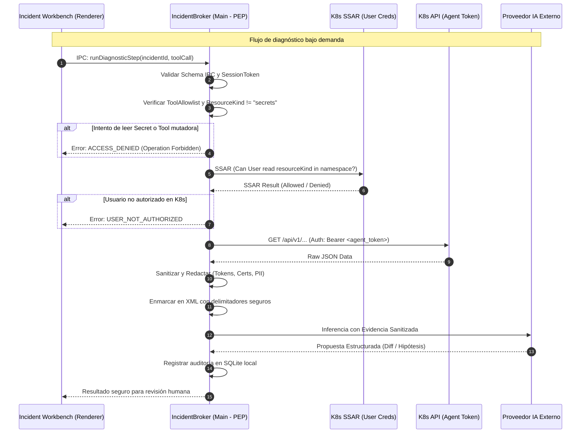

# H8.0 — Arquitectura del Broker y Modelo de Identidad

**Fecha:** 2026-11-05
**Hito:** H8.0 — Fundaciones de Arquitectura y Seguridad
**Historia:** H8-002
**Estado:** REVISADO / PROPUESTA FORMAL

---

## 1. Principio Fundamental de Confianza

En un entorno corporativo o de producción, el usuario operador que ejecuta OpenLens DevOps puede poseer un `kubeconfig` con privilegios amplios (incluso `cluster-admin`).
**Principio de diseño inquebrantable:**
> *Una interfaz de usuario que corre bajo un kubeconfig administrador NO constituye una barrera de seguridad suficiente. La inteligencia artificial y los agentes de diagnóstico NUNCA deben heredar los privilegios del operador humano.*

El acceso al clúster para diagnóstico debe imponer una **doble identidad** verificada en un mediador seguro (Broker) que actúa como Punto de Decisión y Control de Políticas (*Policy Enforcement Point - PEP*) en Electron Main.

---

## 2. Modelo de Identidad Técnica Independiente

Para que la identidad del agente sea verdaderamente independiente y no una simple simulación de código local, se establecen dos niveles:

### 2.1. Nivel Preferente: ServiceAccount Técnico con Bounded Tokens (En-Cluster)
1. **Aprovisionamiento:**
   - En el clúster objetivo, OpenLens DevOps define una identidad de servicio dedicada:
     ```yaml
     apiVersion: v1
     kind: ServiceAccount
     metadata:
       name: openlens-ai-investigator
       namespace: kube-system # o namespace dedicado
     ---
     apiVersion: rbac.authorization.k8s.io/v1
     kind: ClusterRole
     metadata:
       name: openlens-ai-readonly-investigator
     rules:
       - apiGroups: [""]
         resources: ["pods", "pods/log", "events", "services", "configmaps", "persistentvolumeclaims", "nodes"]
         verbs: ["get", "list"]
       - apiGroups: ["apps"]
         resources: ["deployments", "statefulsets", "daemonsets", "replicasets"]
         verbs: ["get", "list"]
       - apiGroups: ["networking.k8s.io"]
         resources: ["ingresses"]
         verbs: ["get", "list"]
     ---
     apiVersion: rbac.authorization.k8s.io/v1
     kind: ClusterRoleBinding
     metadata:
       name: openlens-ai-readonly-investigator-binding
     subjects:
       - kind: ServiceAccount
         name: openlens-ai-investigator
         namespace: kube-system
     roleRef:
       kind: ClusterRole
       name: openlens-ai-readonly-investigator
       apiGroup: rbac.authorization.k8s.io
     ```
2. **Generación de Credenciales Efímeras:**
   - Electron Main **no utiliza tokens estáticos heredados ni secretos de Kubernetes**.
   - Utiliza la API de Kubernetes `TokenRequest` (`AuthenticationV1Api.createNamespacedServiceAccountToken`) para solicitar un token de duración acotada (TTL = 1 hora), asociado a una audiencia específica (`audiences: ["openlens-ai-investigator"]`).
3. **Custodia y No Exposición:**
   - El token se mantiene exclusivamente en memoria (RAM) dentro del proceso de Electron Main.
   - **Bajo ninguna circunstancia se envía el token al Renderer ni al proveedor de IA.**
   - Las llamadas a Kubernetes generadas por herramientas de diagnóstico se firman en Main con este token de ServiceAccount.
4. **Revocación:**
   - **Automática:** El token expira al vencer el TTL de 1 hora.
   - **Inmediata local:** Invocación de `incidentBroker.revokeSession(clusterId)` en Main (purga el token de memoria y cancela conexiones en vuelo).
   - **Inmediata en cluster:** El administrador elimina o suspende el `ClusterRoleBinding` o el `ServiceAccount`.

### 2.2. Nivel Secundario: Modo Restringido Local (Zero-Touch RBAC / Fallback)
En clústeres donde el usuario humano carece de permisos para crear `ServiceAccounts` o `ClusterRoles` (o en clústeres de solo lectura externos):
1. El broker utiliza el cliente de Kubernetes del usuario pero impone **pre-flight checks estrictos vía `SelfSubjectAccessReview` (SSAR)** antes de emitir cualquier lectura.
2. Si la consulta involucra un recurso bloqueado (`secrets`, etc.), el broker deniega la llamada a nivel de cliente antes de enviar paquetes a la red.
3. La UI exhibe un indicador visible de auditoría: `Identidad Técnica: Simulada (Client-Side Only)`.

---

## 3. Matriz de Autorización e Intersección Estricta

Para cada llamada a una herramienta (`tools/call`), el `IncidentBrokerService` evalúa la siguiente conjunción lógica:

$$\text{Decision} = \text{UserAuthz} \land \text{AgentAuthz} \land \text{ToolAllowlist} \land \text{ScopePolicy}$$

Donde:
1. **`UserAuthz` (Permiso Humano):**
   - Comprueba mediante `SelfSubjectAccessReview` que el usuario tenga derecho efectivo de `get` / `list` sobre el recurso y namespace específicos en ese momento.
   - Si el usuario no tiene acceso, se aborta inmediatamente con `ACCESS_DENIED`.
2. **`AgentAuthz` (Permiso de la Identidad IA):**
   - Si se cuenta con el ServiceAccount técnico, la petición física al API Server de Kubernetes se efectúa con las credenciales del agente. Si Kubernetes RBAC deniega, la llamada falla cerrado (HTTP 403).
   - El agente tiene prohibido de raíz el acceso a `secrets`, mutaciones (`create`, `update`, `patch`, `delete`) y subrecursos peligrosos (`exec`, `portforward`, `proxy`).
3. **`ToolAllowlist`:**
   - La herramienta invocada debe pertenecer a `ALLOWLISTED_MCP_TOOLS` y no estar en `FORBIDDEN_WRITE_TOOLS`.
4. **`ScopePolicy`:**
   - La investigación está atada a un `IncidentId` con metadatos específicos: `{ clusterId, namespace, resourceKind, resourceName }`.
   - Cualquier intento de la herramienta por consultar un namespace diferente al declarado en el scope del incidente requiere autorización explícita o se deniega por desbordamiento de alcance.

---

## 4. Diagrama de Secuencia de Autorización



---

## 5. Topología del Mediador: Local vs. Central

Se evaluaron dos arquitecturas para el mediador:

| Criterio | Opción A: Broker Local en Electron Main (Recomendada) | Opción B: Servicio Gateway Central (SaaS / Daemon) |
| :--- | :--- | :--- |
| **Complejidad** | **Baja**. Integrado en el ciclo de vida de la aplicación de escritorio. | **Alta**. Requiere desplegar, operar y autenticar un servidor centralizado. |
| **Privacidad** | **Máxima**. Ningún dato de Kubernetes sale de la máquina local del usuario sin consentimiento. | **Riesgo corporativo**. El gateway centralizado se convierte en un honeypot de credenciales y telemetría. |
| **Soporte Offline / Air-Gapped** | Compatible con clústeres locales (Minikube, Kind, k3s). | Incompatible sin conectividad directa al servicio central. |
| **Autenticación** | Canales IPC protegidos por Electron `contextBridge`. | Requiere OAuth2, mTLS y gestión de sesiones remotas. |

**Decisión formal:** El Broker corre **localmente en el proceso Main de Electron** para todo el alcance de H8.

---

## 6. Estado de Tareas H8-002

- [x] Modelo de doble identidad formalizado (**REVISADO**).
- [x] Especificación de manifiesto RBAC para ServiceAccount independiente (**REVISADO**).
- [x] Fórmula de intersección de permisos $\text{usuario} \cap \text{agente} \cap \text{clúster} \cap \text{namespace} \cap \text{herramienta}$ (**REVISADO**).
- [ ] Implementación de `IncidentBrokerService` en Electron Main (**PENDIENTE de H8.2**).
- [ ] Implementación de rotación de tokens vía `TokenRequest` (**PENDIENTE de H8.2**).
