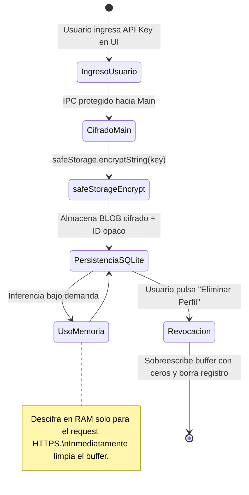

# H8.0 — Persistencia SQLite, Bóveda de Credenciales y Retención

**Fecha:** 2026-11-05
**Hito:** H8.0 — Fundaciones de Arquitectura y Seguridad
**Historia:** H8-004
**Estado:** REVISADO / PROPUESTA FORMAL

---

## 1. Principio de Aislamiento de Persistencia

OpenLens DevOps utiliza actualmente almacenamiento local basado en archivos JSON y `localStorage` (`lens-local-storage`).
**Regla de oro de persistencia H8:**
> *SQLite se incorpora EXCLUSIVAMENTE para el Centro de Incidentes, evidencias acotadas, auditoría y perfiles no sensibles de IA. No se migra ningún dato previo de OpenLens (clústeres, configuraciones, workspaces, preferencias ni layouts).*

---

## 2. Spike Técnico de Selección de SQLite (H8-004)

No se aprueba ciegamente ninguna librería sin validación empírica. Se define un **Spike técnico verificable** a ejecutar en el primer incremento de H8.1 para comparar tres candidatos en Electron 45.2.0 (macOS Apple Silicon ARM64 y plataformas cruzadas):

### 2.1. Candidatos Evaluados

| Candidato | Tipo | Pros | Riesgos Técnicos |
| :--- | :--- | :--- | :--- |
| **A: `better-sqlite3`** | Addon C++ Nativo | Máximo rendimiento, transacciones sincrónicas estándar en la industria. | Requiere compilación `node-gyp` contra headers de Electron 45. Puede quebrar pipelines de CI y empaquetado de DMG si hay desajustes de ABI. |
| **B: `@vscode/sqlite3`** | Prebuilt binaries (Microsoft) | Mantenido activamente para Electron en VS Code; evita compilar en máquina local. | Sujeto a que exista prebuild oficial para la combinación exacta Electron 45 + Node 24 + ARM64. |
| **C: `@sqlite.org/sqlite-wasm`** (o `@vlcn.io/wa-sqlite`) | WebAssembly + Node VFS | **Cero compilación nativa**. 100% portable. Idéntico comportamiento en ARM64, Intel, Windows y Linux. No toca `node-gyp`. | Requiere verificar rendimiento en escrituras con `fsync` y modo WAL sobre Node.js fs. |

### 2.2. Criterios de Aceptación del Spike (Matriz de Validación)

El spike consistirá en un script aislado (`scripts/spikes/sqlite-eval.ts`) que debe superar 5 pruebas automatizadas:

1. **Instalación y Cero Rebuild (`TEST-SQLITE-01`):** Se instala en el monorepo y corre un smoke test sin arrojar errores de `NODE_MODULE_VERSION` mismatch en Electron 45.
2. **Atomicidad y Persistencia Transaccional (`TEST-SQLITE-02`):**
   - Ejecuta 1.000 inserciones dentro de una transacción `BEGIN IMMEDIATE ... COMMIT`.
   - Simula un corte abrupto del proceso (`process.kill(process.pid, 'SIGKILL')`).
   - Al reiniciar, la base de datos no presenta escrituras parciales (o se aplicaron los 1.000 registros o ninguno).
3. **Integridad y Recuperación ante Corrupción (`TEST-SQLITE-03`):**
   - Inyecta bytes corruptos aleatorios en un archivo de prueba.
   - La capa de repositorio detecta el fallo mediante `PRAGMA integrity_check;`.
   - Aplica recuperación segura: renombra a `incidents.db.corrupted.<timestamp>`, crea una base limpia y permite que OpenLens inicie normalmente sin crashear.
4. **Modo WAL y Concurrencia (`TEST-SQLITE-04`):**
   - Configura `PRAGMA journal_mode = WAL;` y `PRAGMA synchronous = NORMAL;`.
   - Verifica lecturas concurrentes sin bloqueo durante escrituras de logs de incidentes.
5. **Empaquetado y Codesign (`TEST-SQLITE-05`):**
   - Verifica que el bundle resultante pueda ser firmado con `codesign --sign -` en macOS ARM64 sin rechazos por dylibs dinámicas no firmadas.

---

## 3. Ciclo de Vida de Credenciales y Bóveda Segura

Las claves de API de proveedores IA (OpenAI, Anthropic, Gemini, etc.) y tokens de acceso son datos altamente sensibles.

### 3.1. Arquitectura de Almacenamiento Cifrado
- **Uso de `safeStorage` nativo de Electron:**
  - En **macOS**: cifra mediante Apple Keychain Services (clave derivada del hardware/Secure Enclave).
  - En **Windows**: cifra mediante DPAPI (Data Protection API).
  - En **Linux**: cifra mediante Secret Service API / libsecret o KWallet.
- **Formato en Base de Datos (SQLite):**
  La tabla `ai_profiles` almacena únicamente metadatos:
  ```sql
  CREATE TABLE ai_profiles (
      id TEXT PRIMARY KEY,
      name TEXT NOT NULL,
      provider TEXT NOT NULL,          -- 'openai' | 'anthropic' | 'gemini' | 'custom'
      endpoint TEXT,                   -- URL base opcional
      model TEXT NOT NULL,
      credential_ref TEXT NOT NULL,    -- Identificador opaco: 'os-vault:<uuid>'
      encrypted_blob BLOB,             -- Buffer retornado por safeStorage.encryptString()
      is_active INTEGER DEFAULT 0,
      created_at TEXT NOT NULL,
      updated_at TEXT NOT NULL
  );
  ```
  *Bajo ningún concepto se persiste la API key en texto plano.*

### 3.2. Ciclo de Vida Completo



### 3.3. Comportamiento ante Ausencia de Bóveda Segura (Fallback Fail-Closed)
Si el entorno no dispone de un almacén seguro del sistema operativo (por ejemplo, en entornos CI o distribuciones Linux sin gestor de contraseñas configurado, donde `safeStorage.isEncryptionAvailable() === false`):
1. **Política Fail-Closed:** OpenLens DevOps **NO** guardará las claves en texto plano en disco.
2. **Alternativas para el Usuario:**
   - **Opción A (Memoria de Sesión):** La clave se conserva únicamente en la memoria RAM del proceso Main durante la sesión activa. Al cerrar la aplicación, la clave se descarta y deberá reingresarse en el siguiente inicio.
   - **Opción B (Master Passphrase opt-in):** Si el usuario requiere persistencia, se le solicita una contraseña maestra de sesión con la que se deriva una clave criptográfica (AES-256-GCM vía PBKDF2 con 100.000 iteraciones) para cifrar los tokens localmente.

### 3.4. Política de Backups y Exportaciones
- Al exportar incidentes para compartirlos o respaldarlos, **las credenciales y perfiles de IA se excluyen obligatoriamente**.
- La restauración en otro equipo requerirá reconectar las cuentas y volver a ingresar las credenciales correspondientes.

---

## 4. Política de Retención y Purga de Incidentes

Para evitar el crecimiento desmedido de la base de datos local y proteger la privacidad:

### 4.1. Configuración de Retención
La duración de conservación de incidentes es **configurable por el usuario** desde Ajustes:
- Opciones disponibles:
  - Conservación manual / indefinida (hasta eliminación explícita).
  - 30 días.
  - 60 días.
  - 90 días.
  - 180 días.
  - 365 días.
  - Plazo personalizado (en días).
- **Valor por defecto:** **`PENDIENTE DE DECISIÓN FORMAL DE PRODUCTO`** (no se fuerza 90 días arbitrariamente; se propondrá 90 días con advertencia de espacio para validación del usuario).

### 4.2. Segregación de Retención: Ficha vs. Evidencias Voluminosas
- **Ficha del Incidente (Metadatos, Timeline, Hipótesis, Diff):** Se conserva durante el plazo completo configurado (ej. 90 días).
- **Evidencias Voluminosas (Logs crudos, eventos detallados):** Tienen una política de purga acelerada opcional (por defecto 15 días) para ahorrar espacio, conservando únicamente las citas y fragmentos indispensables que justifican las hipótesis.
- **Protección de Incidentes Críticos ("Pin / Protect"):** El usuario puede marcar un incidente como "Fijado / Protegido", lo cual lo excluye de cualquier rutina de purga automática hasta que sea desprotegido manualmente.

---

## 5. Esquema de Base de Datos y Migraciones Versionadas

### 5.1. Control de Migraciones
Se implementa una tabla de control:
```sql
CREATE TABLE IF NOT EXISTS schema_migrations (
    version INTEGER PRIMARY KEY,
    applied_at TEXT NOT NULL,
    description TEXT NOT NULL
);
```
Las migraciones se ejecutan de forma secuencial e idempotente en transacciones aisladas (`001_initial_incident_schema.sql`, etc.).
Antes de aplicar cualquier migración, el sistema realiza una copia de respaldo automática `incidents.db.pre-mig-<version>.bak`.

---

## 6. Estado de Tareas H8-004 y H8-005

- [x] Especificación del spike comparativo SQLite con 5 criterios de aceptación (**REVISADO**).
- [x] Ejecución del spike `TEST-SQLITE-01` a `05` en Electron 45 ARM64 (**PROBADO / PASS: better-sqlite3 seleccionado**).
- [x] Implementación de `SqliteClient` con WAL, foreign keys y busy timeout (**IMPLEMENTADO / PROBADO**).
- [x] Migraciones atómicas y versionadas (`schema_migrations`, `001_initial_incident_schema.sql`) (**IMPLEMENTADO / PROBADO**).
- [x] Detección de corrupción y cuarentena sin pérdida de datos (`.corrupted.<timestamp>.bak`) (**IMPLEMENTADO / PROBADO**).
- [x] Implementación de `IncidentRepository` con CRUD tipado, timeline y evidencias (**IMPLEMENTADO / PROBADO**).
- [x] Pruebas unitarias focalizadas Jest (15/15 PASS) y smoke en Electron 45 real (**PROBADO**).
- [ ] Bóveda de credenciales `credentials-vault.ts` con `safeStorage` (**PENDIENTE de H8.3**).
- [ ] Panel de preferencias de retención y purga de incidentes vencidos (**PENDIENTE de H8.1 / H8-009**).
