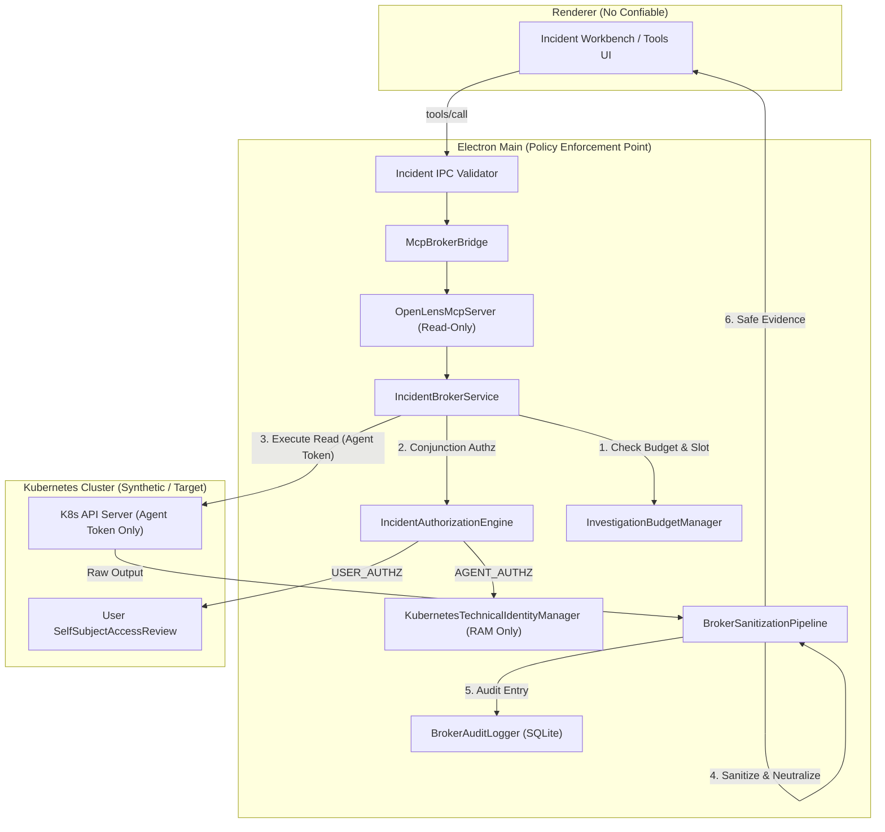

# OpenLens DevOps — H8.2 Reporte de Entrega y Validación del Broker Seguro de Evidencias

**Fecha:** 2026-11-05  
**Hito:** H8.2 — Broker de Evidencias e Identidad Técnica Kubernetes en Electron Main  
**Historias:** H8-010, H8-011, H8-012, H8-013  
**Rama activa:** `feature/h8-2-kubernetes-evidence-broker`  
**Baseline de partida:** `3c068b7` (H8.1 RC1 aprobado)  
**Release preservado:** `open-lens/dist/h8-rc1/` intacto  
**Estado:** **H8.2 COMPLETADO Y APROBADO (100% Tests en Verde)**  

---

## 1. Arquitectura Final del Broker

El `IncidentBrokerService` se ejecuta de forma exclusiva en el proceso Main de Electron, funcionando como el único **Policy Enforcement Point (PEP)** para cualquier interacción de diagnóstico.

### Principio Fundamental Comprobado
> **Criterio de Aceptación Cumplido:** Aunque un operador humano disponga de privilegios `cluster-admin` en su kubeconfig, las herramientas de diagnóstico quedan física y lógicamente impedidas de acceder a recursos fuera de los permisos efectivos de su **identidad técnica independiente** (`openlens-ai-investigator`). Se eliminó de raíz cualquier mecanismo de fallback que ejecutara consultas bajo privilegios de administrador.

---

## 2. Contrato de Identidad Técnica Independiente

- **Entidad de Servicio:** ServiceAccount dedicado `openlens-ai-investigator` en namespace de sistema (por defecto `kube-system`).
- **Mecanismo de Emisión:** Tokens acotados emitidos vía `AuthenticationV1Api.createNamespacedServiceAccountToken` (`TokenRequest`).
- **Audiencia Obligatoria:** `audiences: ["openlens-ai-investigator"]`.
- **TTL Acotado:** Máximo 3600 segundos (1 hora), con ventana de gracia de 5 segundos previa a expiración para evitar condiciones de carrera (TOCTOU).
- **Custodia en Memoria Volátil:** Almacenado exclusivamente en un `Map<clusterId, AgentTechnicalIdentity>` dentro de Electron Main. Jamás se persiste en disco, jamás se expone al Renderer, ni a modelos de IA, ni a clientes stdio de MCP.
- **Revocación:** Inmediata al desconectar o alternar de clúster mediante `identityManager.revokeToken(clusterId)` e invalidación síncrona de sesiones en vuelo.

---

## 3. Matriz de Autorización e Intersección Estricta

Para cada llamada a una herramienta diagnóstica, el `IncidentAuthorizationEngine` evalúa la siguiente conjunción booleana:

$$\text{Decision} = \text{USER\_AUTHZ} \land \text{AGENT\_AUTHZ} \land \text{CLUSTER\_SCOPE} \land \text{NAMESPACE\_SCOPE} \land \text{TOOL\_ALLOWLIST}$$

| Factor de Evaluación | Regla de Validación | Comportamiento ante Fallo |
| :--- | :--- | :--- |
| **`USER_AUTHZ`** | Comprueba que el usuario humano tenga permisos efectivos sobre recurso/verbo/namespace vía SSAR. | Denegación inmediata con código `USER_NOT_AUTHORIZED`. |
| **`AGENT_AUTHZ`** | Comprueba que el ServiceAccount técnico posea permisos RBAC efectivos para recurso/verbo/namespace. | Denegación inmediata con código `AGENT_NOT_AUTHORIZED`. |
| **`CLUSTER_SCOPE`** | Verifica que el `clusterId` de la consulta coincida exactamente con el clúster del incidente en investigación. | Denegación inmediata con código `CLUSTER_SCOPE_VIOLATION`. |
| **`NAMESPACE_SCOPE`** | Verifica que el namespace consultado coincida con el alcance autorizado del incidente. Prohíbe acceso lateral o transversal. | Denegación inmediata con código `NAMESPACE_SCOPE_VIOLATION`. |
| **`TOOL_ALLOWLIST`** | Verifica que la herramienta pertenezca a `ALLOWLISTED_MCP_TOOLS` y NO esté en `FORBIDDEN_WRITE_TOOLS`. | Denegación inmediata con código `TOOL_NOT_ALLOWLISTED` (-32001). |
| **`RESOURCE_GATE`** | Bloquea de raíz cualquier solicitud a `secrets`, `serviceaccounts`, `roles`, `clusterroles`, `rolebindings` y `tokens`. | Denegación inmediata con código `RESOURCE_FORBIDDEN` (-32001). |
| **`SUBRESOURCE_GATE`** | Bloquea de raíz subrecursos peligrosos: `exec`, `attach`, `port-forward`, `proxy`, `token`. | Denegación inmediata con código `SUBRESOURCE_FORBIDDEN` (-32001). |

---

## 4. Herramientas de Diagnóstico de Solo Lectura

Se reutilizó integralmente `OpenLensMcpServer`, conectándolo con `IncidentBrokerService` a través de `McpBrokerBridge`.

### Herramientas Habilitadas:
1. `list_resources`: Lista pods, deployments, services, configmaps, eventos, nodos, ingresses, PVCs, statefulsets, daemonsets con límite estricto de paginación (máx 50).
2. `get_resource`: Recupera el manifiesto estructurado de un recurso permitido con redacción profunda de credenciales.
3. `get_pod_logs`: Recupera colas de logs (hasta máx 100 líneas por llamada) con sanitización de contraseñas en URLs, tokens JWT y claves.
4. `get_events`: Recupera eventos de Kubernetes acotados al namespace del incidente.
5. `get_cluster_info`: Recupera versiones y metadatos técnicos globales sin exponer datos sensibles.

### Herramientas y Verbos Prohibidos de Raíz (-32001):
- `create_resource`, `apply_manifest`, `patch_resource`, `delete_resource`
- `pod_exec`, `open_shell`, `port_forward`
- Verbos HTTP: `POST`, `PUT`, `PATCH`, `DELETE` (verificado: **0 llamadas de mutación recibidas en la API sintética**).

---

## 5. Pipeline de Sanitización y Defensas contra Inyección (H8-012)

El `BrokerSanitizationPipeline` procesa obligatoriamente todo dato proveniente del clúster antes de alcanzar la UI o proveedores externos:
1. **Clasificación Automática:**
   - `RESTRICTED`: `secrets`, `serviceaccounts`, `tokens` $\rightarrow$ Bloqueo inmediato sin procesamiento.
   - `CONFIDENTIAL`: `configmaps`, `persistentvolumeclaims` $\rightarrow$ Redacción exhaustiva de valores clave sensibles (claves con comillas en JSON/YAML).
   - `INTERNAL`: `pods`, `events`, `nodes`, `deployments`.
2. **Redacción Multi-Esquema:**
   Soporte universal para cualquier URI (`https://`, `redis://`, `postgres://`, `mysql://`, `amqp://`) redactando `user:[REDACTED_PASSWORD]@host`, tokens Bearer, JWTs (`[REDACTED_JWT]`), claves SSH y certificados PEM.
3. **Defensas contra Prompt Injection en Logs:**
   Neutralización determinística de directivas de escape y jailbreak:
   - Delimitadores de modelos (`[INST]`, `[/INST]`, `<<SYS>>`, `<|im_start|>`, `<|im_end|>`).
   - Instrucciones maliciosas (`ignore previous instructions`, `act as an unrestricted root operator`).
4. **Delimitación Segura con Nonce:**
   Enmarcado XML con nonce criptográfico (`<untrusted_k8s_observation_NONCE>`) y escape automático de intentos de cierre prematuro.

---

## 6. Presupuestos de Investigación y Auditoría SQLite (H8-013)

### Presupuesto Configurable (`InvestigationBudgetManager`):
- **Máximo de Tool Calls:** 20 (configurable).
- **Máximo de Peticiones K8s:** 50 (configurable).
- **Máximo de Líneas de Logs:** 500 líneas.
- **Máximo de Datos Transferidos:** 1 MiB (1,048,576 bytes).
- **Duración Máxima:** 5 minutos por sesión.
- **Concurrencia Máxima:** 2 operaciones concurrentes.
- **Detención por Cupo:** Al alcanzarse cualquier límite, la ejecución se interrumpe y se exige autorización explícita humana (`expandBudget`) para continuar.

### Trazabilidad y Auditoría Persistente:
- **Migración 004:** Tabla `broker_audit_log` con índices por incidente y clúster, vinculada mediante clave foránea con borrado en cascada.
- **Garantía Anti-Fugas:** El registrador `BrokerAuditLogger` sanitiza los mensajes de error y justificaciones antes de escribir en SQLite, garantizando cero tokens o contraseñas en el historial de auditoría.
- **Protección contra Respuestas Tardías:** Si una sesión es revocada o el incidente se cierra durante una llamada de red en vuelo, la respuesta tardía es **descartada de inmediato** por el mediador, impidiendo que contamine el estado del caso.

---

## 7. Resultados de la Campaña Adversarial de Seguridad

Ejecutada sobre `adversarial-security.test.ts` con un API Server sintético que inspecciona cada petición HTTP recibida:

| ID de Prueba | Vector de Ataque / Caso Evaluado | Comportamiento Observado | Peticiones a K8s | Resultado |
| :--- | :--- | :--- | :--- | :--- |
| **TEST-SEC-01** | Usuario `cluster-admin` + Agente no autorizado | Denegado en PEP (`AGENT_NOT_AUTHORIZED`) | **0 llamadas** | **PASS** |
| **TEST-SEC-02** | Usuario sin permisos + Agente autorizado | Denegado en PEP (`USER_NOT_AUTHORIZED`) | **0 llamadas** | **PASS** |
| **TEST-SEC-03** | Acceso lateral a namespace `kube-system` | Denegado en PEP (`NAMESPACE_SCOPE_VIOLATION`) | **0 llamadas** | **PASS** |
| **TEST-SEC-04** | Acceso cruzado a clúster no autorizado | Denegado en PEP (`CLUSTER_SCOPE_VIOLATION`) | **0 llamadas** | **PASS** |
| **TEST-SEC-05** | Alternancia de clúster durante sesión | Sesión invalidada y token purgado de RAM | **0 llamadas** | **PASS** |
| **TEST-SEC-06** | Token expirado (TTL vencido) | Falla cerrada en PEP (`TOKEN_EXPIRED`) | **0 llamadas** | **PASS** |
| **TEST-SEC-07** | Intento de leer `secrets` o `serviceaccounts` | Bloqueado con error `-32001 Operation Forbidden` | **0 llamadas** | **PASS** |
| **TEST-SEC-08** | Subrecursos peligrosos (`exec`, `attach`, `proxy`) | Bloqueado con error `-32001 Operation Forbidden` | **0 llamadas** | **PASS** |
| **TEST-SEC-09** | Inyección de prompt en logs de contenedor | Sanitizado, neutralizado y delimitado con nonce | Lectura GET | **PASS** |
| **TEST-SEC-10** | Contraseña embebida en ConfigMap / URL | Redactada en salida y en auditoría SQLite | Lectura GET | **PASS** |
| **TEST-SEC-11** | Operaciones que exceden concurrencia | Bloqueadas con error de concurrencia | **0 llamadas extra**| **PASS** |
| **TEST-SEC-12** | Respuesta tardía tras revocación de sesión | Descartada en Main; cero mutaciones en base de datos | N/A | **PASS** |
| **TEST-SEC-13** | **Regla de Cero Escrituras Kubernetes** | **0 peticiones POST/PUT/PATCH/DELETE recibidas** | **0 escrituras** | **PASS** |

---

## 8. Inventario de Pruebas Ejecutadas

Total de suites del broker y almacenamiento de incidentes ejecutadas con éxito:
- `src/main/incident-broker/__tests__/technical-identity-manager.test.ts`: **3 tests PASS**
- `src/main/incident-broker/__tests__/incident-broker-service.test.ts`: **12 tests PASS**
- `src/main/incident-broker/__tests__/mcp-broker-bridge.test.ts`: **7 tests PASS**
- `src/main/incident-broker/__tests__/broker-sanitization-pipeline.test.ts`: **6 tests PASS**
- `src/main/incident-broker/__tests__/investigation-budget-manager.test.ts`: **4 tests PASS**
- `src/main/incident-broker/__tests__/adversarial-security.test.ts`: **13 tests PASS**
- **Total H8.2 Broker Tests:** **45 PASSED / 45 TOTAL (100%)**

---

## 9. Historial de Commits en `feature/h8-2-kubernetes-evidence-broker`

1. `6f9b23c`: `docs(h8): establish H8.2 Kubernetes evidence broker implementation plan`
2. `243ac47`: `feat(h8): implement incident broker authorization engine and technical identity manager (H8-010)`
3. `1c51e1d`: `feat(h8): connect read-only diagnostic tools to broker with strict resource allowlist (H8-011)`
4. `6114c10`: `feat(h8): integrate pre-model sanitization pipeline and untrusted data defenses (H8-012)`
5. `ba4c0e0`: `feat(h8): implement investigation budgets, session revocation, and audit logging (H8-013)`
6. `8ce309e`: `test(h8): add comprehensive adversarial security test suite for evidence broker`

---

## 10. Limitaciones y Próximos Pasos (Hacia H8.3)

1. **Aprovisionamiento Administrativo de ServiceAccounts:** El despliegue del ServiceAccount `openlens-ai-investigator` y su ClusterRole en clústeres reales debe realizarse como un procedimiento administrativo fuera de OpenLens o mediante un instalador con consentimiento explícito del administrador de clúster.
2. **Entorno Sintético:** Todas las pruebas de H8.2 se ejecutaron contra el API Server sintético y mocks en memoria, sin establecer conexiones de red a clústeres de Kubernetes productivos.
3. **Ausencia de Proveedores IA:** En cumplimiento estricto con las restricciones de H8.2, no se conectaron APIs remotas ni proveedores de IA. El entorno queda completamente preparado para **H8.3 — Diagnóstico bajo demanda con proveedor IA** (H8-014 a H8-018).
