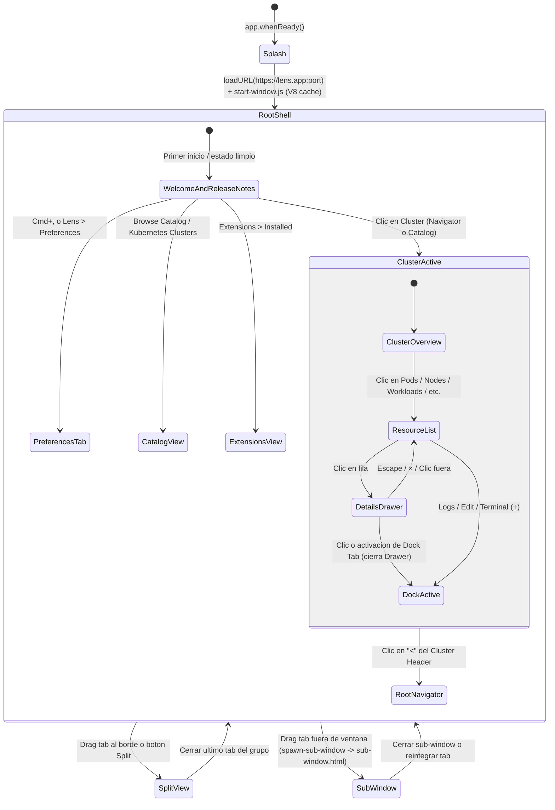

# Mirantis Lens 2026.11 — Máquina de Estados de Navegación y Ventanas

## Reglas Clave de Transición

1. **Sin desmontaje del shell raíz**: `TopBar`, `Hotbar`, `Navigator`, `WorkspaceTabBar` y `StatusBar` permanecen montados en `Welcome`, `Release Notes`, `Preferences`, `Extensions`, `Catalog` y vistas de clúster (`CONFIRMED` vía `r12-lens-preferences-real.png`, `r8-1-topbar-lens.png`).
2. **Navegación interna por tabs (`@lensapp/main-view`)**: `page.goto()` externo recarga la SPA; la navegación normal ocurre vía clicks/comandos internos que abren o seleccionan tabs en `main-view-tab-groups` (`CONFIRMED` en `:9224`).
3. **Subventanas (`sub-window`)**: Usan `sub-window.html` y canales `spawn-sub-window` / `dismiss-sub-window` / `retitle-sub-window` manteniendo el mismo bundle con V8 code cache (`CONFIRMED` en `main.js` + `app.asar`).
