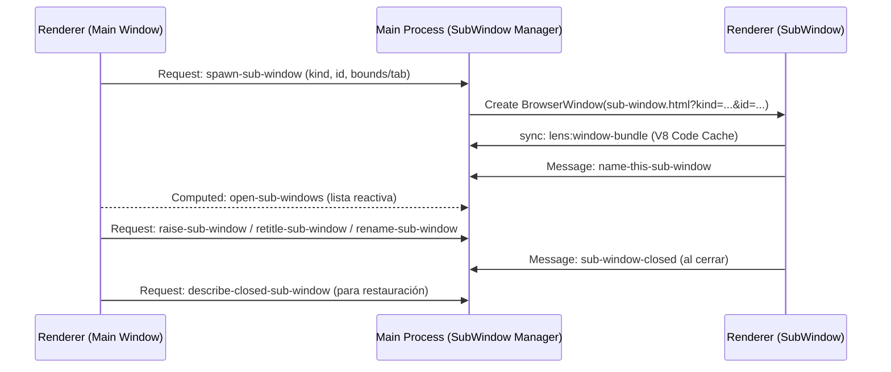

# R12.1-C — Arquitectura de Subventanas (`sub-window`)

- **HTML**: `static/build/sub-window.html` (carga `/reload-when-bundle-is-back.js` y `/start-window.js`, usando el mismo `lens.js` con V8 Code Cache).
- **Identificación por Query Params** (`main.js` `getSubWindowSearchParams` / `parseSubWindowSearchParams`): `?kind=<kindId>&id=<id>`.
- **Scopes de Inyección**: `main.js` y `lens.js` distinguen `"application-window-only"` vs `"sub-window-only"`, cargando solo las features pertinentes en cada tipo de ventana.

## Ciclo de Vida Observado en Canales IPC

## Canales Asociados (`CONFIRMED`)
- **Request**: `spawn-sub-window`, `raise-sub-window`, `dismiss-sub-window`, `retitle-sub-window`, `rename-sub-window`, `has-sub-window`, `sub-window-descriptor`, `describe-closed-sub-window`.
- **Message**: `name-this-sub-window`, `sub-window-opening-use`, `sub-window-closed`.
- **Computed**: `open-sub-windows`.
- **Cross-Window Sync**: `window-messaging-relay-message`, `window-messaging-relay-request`, `window-messaging-answer-request`, `window-messaging-observe`, `window-messaging-publish-value`.
