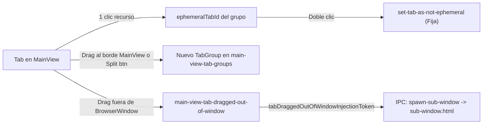

# R12.1-D — Sistema de Workspace Tabs, Grupos, Split Screen y Drag-Out

Extraído de `static/build/lens.js` (`/tmp/lens-r12-1-d-renderer-index.json`) y verificado contra comportamiento documentado en Release Notes 2026.11 y `:9224`.

## 1. Modelo de Tab Groups y Tabs Efímeras (`CONFIRMED`)

- **Tab Groups (`tab-groups-reactive`)**:
  - Los grupos se almacenan por `id` y se ordenan por `orderNumber` (`byOrderNumber`).
  - Existe foco activo por grupo (`set-focused-tab-group-id`) y atajos dedicados (`split-tab-group-keyboard-shortcut`, `focus-next-tab-group-keyboard-shortcut`).
  - Ancho mínimo/base observado en constante vecina: `280` (`Tqe=280`), persistido vía `main-view-groups-width-state`.
- **Tabs Efímeras (`ephemeralTabId`)**:
  - Cada grupo mantiene un único `ephemeralTabId` en su estado (`a?.ephemeralTabId === tabId`).
  - **Fijar tab (`set-tab-as-not-ephemeral`)**: Al hacer doble clic (o fijar), limpia `ephemeralTabId: undefined` en ese grupo (`r.set(a.id, {...a, ephemeralTabId: void 0})`).
  - También existe acción global `set-all-tabs-as-not-ephemeral`.

## 2. Drag-to-Edge Split & Drag-Out a `sub-window`

