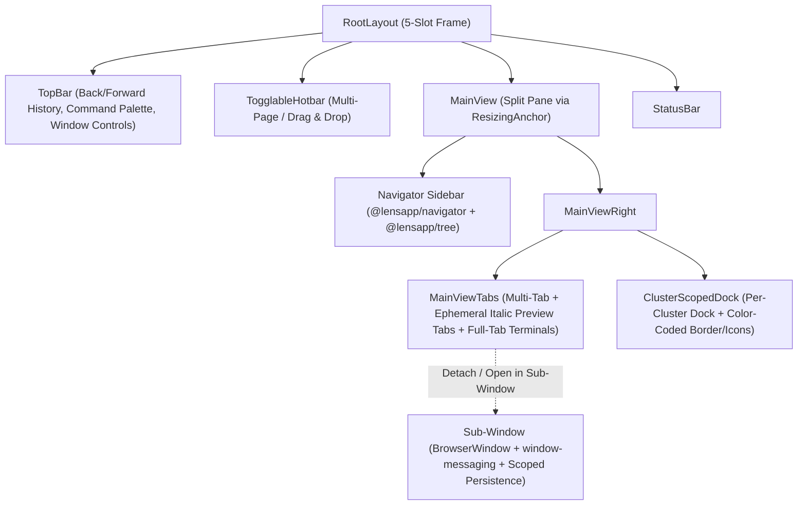

# Official Lens (`2026.10.121159-latest`) vs. OpenLens (`6.5.3-dev` + `feat/openlens-devops-revival`) — Complete Feature & Architecture Catalog

> [!IMPORTANT]
> **Target Analyzed:** `/Applications/Lens.app` (`2026.10.121159-latest`, signed `2026-10-12`)
> **Repository Compared:** [`/Users/gustavomarcon/Documents/lens/lens`](file:///Users/gustavomarcon/Documents/lens/lens/ROADMAP.md) (`OpenLens 6.5.3-dev` + uncommitted changes on `feat/openlens-devops-revival`)

---

## 1. REA MCP Evidence Ledger & Platform Baseline

| Artifact / Binary | Path | SHA-256 | REA Evidence ID | Key Observations |
| :--- | :--- | :--- | :--- | :--- |
| **Application Bundle (`Info.plist` & Signature)** | `/Applications/Lens.app/Contents/MacOS/Lens` | `65c142a89d85f7ed0102c905335aa8b258d8b0612f31a01ff52e0866d6ecaade` | `ev_b40fba1684998ea6436ce8e4d411b9ae48485ab358607175ffa2adb5a54f7973`, `ev_264882b2fe5006c3f1cad25869826ba82e183d42c4b66573905ef81b82a07c10` | `com.electron.kontena-lens`, version `2026.10.121159-latest`, min macOS `13.0`, Hardened Runtime + JIT entitlement. |
| **Electron Framework Fuses** | `/Applications/Lens.app/Contents/Frameworks/Electron Framework.framework/Versions/A/Electron Framework` | `11ab8f10485da75148d25eb4f0203803fb9e02e8308385a948cf924a2b2f25a0` | `ev_67e937a0ae9dc1818600a452a3c8e52daec46e83630a5dc65aac386a4c385bda` | Electron `44.4.2` (Chromium `152`), `RunAsNode=enabled`, `EnableNodeCliInspectArguments=enabled`, `EnableEmbeddedAsarIntegrityValidation=disabled`. |
| **Application Archive (`app.asar`)** | `/Applications/Lens.app/Contents/Resources/app.asar` | `66338fe78ae93c5f35ccef65a4a2b71b863f2b86db06af2421fa2a470e69a1a9` | `ev_7e8e7d94f0c3b53bd9cd22fbd6c6a34b667ae83f59ae889c13050b509af2af61`, `ev_16c036be7a35df8c248f04b0c32002028cf99e943cac571bfd568be3a34956bc` | 18,687 relevant files, 125 `@lensapp/*` packages, 39 `@k8slens/*` packages, 3 bundles (`lens.js`, `main.js`, `sub-window.js`) with full source maps. |
| **Internal K8s Proxy (`lens-k8s-proxy`)** | `/Applications/Lens.app/Contents/Resources/arm64/lens-k8s-proxy` | `7d89e9eed48959723a2defd35e3e34de2d4fc9d5339acb91a2f4123d67d2a87b` | `ev_30ad60a1fa5c8e0977acba008196b90e9957476336a3a10e278e7050e5b56536`, `ev_f5a80d6868e6e9183ce8911e88fc634aedb23c4c91ef86bd02f8006fd41fefb3` | `v0.4.0` (commit `9cbcab3`), compiled with `go1.24.1`, `k8s.io/client-go v0.32.3`, `kustomize/api v0.19.0`. |
| **Bundled `helm`** | `/Applications/Lens.app/Contents/Resources/arm64/helm` | `2954202e5f3308475422c7697dc2c1b1d97ba6a5bee7c60c552a32e390d50667` | `ev_b68d700dc04f345d9f2c04eef512ad1470367594024158b90c08d97ea57ac1c6` | `v3.20.2`, compiled with `go1.25.9`, `k8s.io/client-go v0.35.1`, `oras.land/oras-go/v2 v2.6.0`. |
| **Bundled `kubectl`** | `/Applications/Lens.app/Contents/Resources/arm64/kubectl` | `1b41919f57674d50fc7c4d1a2e97da437222ac8a1e6d6e4da7cfc5373614ddff` | `ev_1058c4b4a4fd826282093932eb7ee54473b07941e164cecd361c959a013e4cb6` | Fallback `1.27.16` (`go1.22.5`), plus dynamic per-cluster `kubectl` downloader up to **`1.35.3`**. |
| **Bundled `lens-cli`** | `/Applications/Lens.app/Contents/Resources/cli/bin/lens-cli-darwin-arm64` | `d3e5bea95f3f3c5a9309cbc1bd2fd3eaeb9c09c4b58dd5ae37e86f37c16863e4` | `ev_17f3e5c7c56e238c2fbeb80a96d82dd853056b8fd3fb559be2f69f2264bc9a76` | Go CLI (`packages/business-features/lens-cli/cli`); also invoked for `get-eks-token`, `get-aks-token`, `get-gke-token`, and `mcp-server`. |
| **Azure MSAL Native Runtime** | `/Applications/Lens.app/Contents/Resources/app.asar.unpacked/node_modules/@azure/msal-node-runtime/dist/macos/arm64/libmsalruntime.dylib` | `09cb9d3da6a3069e0c7dc5068f444bc3d9d7923d62b4794b3e9bc54245b9ad04` | `ev_66a2d1026b6cc70944a3765700443fc25596499507985f24d90e57b307be4dab` | Native macOS arm64 broker/token cache library for Azure AKS authentication. |

### Stack Comparison Summary

| Layer | OpenLens (`6.5.3-dev` Repo) | Current Revival Branch (`feat/openlens-devops-revival`) | Official Lens (`2026.10.121159-latest`) |
| :--- | :--- | :--- | :--- |
| **Electron / Node** | Electron `22.3.3` / Node `16–20` | Electron `22.3.3` / Node `20.20.2` | Electron `44.4.2` / Node `^24.0.0` |
| **React / MobX / TS** | React `17` / MobX `6` / TS `4.9` | Unchanged | React `19.2.0` / MobX `6.12.4` / TS `7.0.2` |
| **Monaco Editor** | `0.34.1` | Unchanged | `0.52.2` |
| **Table Engine** | `react-virtualized` (legacy) | Unchanged | `@tanstack/react-table` + `@tanstack/react-virtual` |
| **Bundled Binaries** | `kubectl 1.25.16`, `helm 3.11.0`, `proxy 0.3.0` | Same binaries + `kubectl-versions` table updated to `1.37` | `kubectl 1.27.16` (auto-downloads up to `1.35.3`), `helm 3.20.2` (k8s `0.35.1`), `proxy 0.4.0` (k8s `0.32.3`) |

---

## 2. What You Already Added in `feat/openlens-devops-revival`

Before listing the missing features from Official Lens, these items are **already implemented** in your local working tree:
1. **Isolated Product Identity**: `OpenLens DevOps` (`dev.drko.openlens-devops`), `openlens-devops://` protocol handler ([`vars.ts`](file:///Users/gustavomarcon/Documents/lens/lens/packages/core/src/common/vars.ts)), `~/.openlens-devops` dot-directory, and `isPackagedAppInjectable` ([`is-packaged-app.injectable.ts`](file:///Users/gustavomarcon/Documents/lens/lens/packages/core/src/common/vars/is-packaged-app.injectable.ts)).
2. **Verifiable YAML / ConfigMap / Secret Saving & 409 Conflict Rebase**: Optimistic `PUT` with `resourceVersion` for `ConfigMap`/`Secret`, read-back `GET` verification (`verifySaved`), `409 Conflict` detection with `SaveConflictNotice` and `"Re-apply my changes on the cluster version"`, and removal of the `k8slens-edit-resource-version` label ([`edit-resource-model.injectable.tsx`](file:///Users/gustavomarcon/Documents/lens/lens/packages/core/src/renderer/components/dock/edit-resource/edit-resource-model/edit-resource-model.injectable.tsx), [`save-verification.ts`](file:///Users/gustavomarcon/Documents/lens/lens/packages/core/src/renderer/components/dock/edit-resource/edit-resource-model/save-verification.ts)). *(Note: This is actually **more reliable** than Official Lens's `edit-resource-model`, which still uses `rfc6902` PATCH without `resourceVersion` or read-back GET!)*
3. **Pod DevOps Menu, Direct `PodShellSession`, Force Delete & Evict**: Direct `kubectl exec` session ([`pod-shell-session.ts`](file:///Users/gustavomarcon/Documents/lens/lens/packages/core/src/main/shell-session/pod-shell-session/pod-shell-session.ts)), unified Pod context menu (`Terminal`, `Logs`, `Port Forward` with container status bricks in [`pod-devops-menu.tsx`](file:///Users/gustavomarcon/Documents/lens/lens/packages/core/src/renderer/components/workloads-pods/pod-devops-menu.tsx)), and Pod **Force Delete** (`gracePeriodSeconds: 0` + finalizer patch) & **Evict** ([`kube-object-menu.tsx`](file:///Users/gustavomarcon/Documents/lens/lens/packages/core/src/renderer/components/kube-object-menu/kube-object-menu.tsx)).
4. **Cluster Appearance Picker & Dialog**: 12 environment color presets + custom color + 12 Material icon presets in Cluster Settings and Hotbar context menu ([`cluster-appearance-picker.tsx`](file:///Users/gustavomarcon/Documents/lens/lens/packages/core/src/renderer/components/cluster-settings/cluster-appearance-picker.tsx), [`cluster-appearance-dialog.tsx`](file:///Users/gustavomarcon/Documents/lens/lens/packages/core/src/renderer/components/cluster-settings/cluster-appearance-dialog.tsx)).
5. **Port-Forward Lifecycle Hardening**: Default bind to `127.0.0.1` ([`port-forward.ts`](file:///Users/gustavomarcon/Documents/lens/lens/packages/core/src/main/routes/port-forward/functionality/port-forward.ts)), stop on cluster disconnect ([`cluster-connection.injectable.ts`](file:///Users/gustavomarcon/Documents/lens/lens/packages/core/src/main/cluster/cluster-connection.injectable.ts)), and stop on app quit ([`stop-port-forwards-on-quit.injectable.ts`](file:///Users/gustavomarcon/Documents/lens/lens/packages/core/src/main/routes/port-forward/functionality/stop-port-forwards-on-quit.injectable.ts)).
6. **Partial Kubeconfig & Kubectl Version Fixes**: Preserved `tls-server-name` in `dumpConfigYaml` ([`kube-helpers.ts`](file:///Users/gustavomarcon/Documents/lens/lens/packages/core/src/common/kube-helpers.ts)) and added K8s `1.30–1.37` mappings in [`versions.json`](file:///Users/gustavomarcon/Documents/lens/lens/packages/kubectl-versions/build/versions.json).

---

## 3. Complete Catalog of New Features in Official Lens (`2026.10`) Not Yet in OpenLens

### Category A — Visual, UI & UX Overhaul

| ID | Feature | What Official Lens Does (`2026.10.121159-latest`) | Key Official Modules | Integration Complexity |
| :--- | :--- | :--- | :--- | :--- |
| **UI-01** | **Multi-Tab Workspace & VS Code-Style Ephemeral Preview Tabs** | Replaces single-view routing with horizontal draggable tabs (`@hello-pangea/dnd`). Single-clicking in the sidebar opens an **ephemeral preview tab** (italic title) that gets replaced on the next single-click; double-clicking pins it as a permanent tab. Middle-click closes; right-click offers `Close`, `Close All`, `Close Others`, `Close to the Right`. | `packages/technical-features/main-view/*`, `packages/technical-features/tab-contracts/*` | Medium–High |
| **UI-02** | **Unified Virtualized Navigator Tree with Drill-Down** | Replaces the separate Catalog + per-cluster iframe sidebar with a single virtualized tree (`@lensapp/navigator` + `@lensapp/tree`, `rowHeight: 24`) showing all clusters, folders, workloads, and extensions. Includes **Drill-Down** (`drillDownInNavigatorInjectable`) to focus the tree on a single cluster/folder, inline node creation/renaming, and full keyboard navigation (`Arrow`, `Enter`, `Shift+Enter`). | `packages/technical-features/_ui-components/individual/navigator/*`, `packages/technical-features/_ui-components/individual/tree/*` | High |
| **UI-03** | **Multi-Window / Sub-Windows (`sub-window` + `window-messaging`)** | Any resource view or tab can be opened in a dedicated Electron `BrowserWindow` (`sub-window.html`). Excludes main chrome (`TopBar`, `Hotbar`, `Navigator`), scopes table/UI persistence per sub-window (`["sub-window", kind, id]`), syncs MobX state across windows via IPC (`window-messaging`), lists open sub-windows in the macOS `Window` menu, and restores open sub-windows across app restarts (`keepSubWindowsAcrossRestartsInjectable`). | `packages/features/sub-window/*`, `packages/features/window-messaging/*`, `src/sub-window/index.ts` | High |
| **UI-04** | **Cluster Color Propagation Across Chrome & Tree Guides** | Beyond just the Hotbar icon (which you already added in `ClusterAppearancePicker`), Official Lens propagates the cluster color to: (1) vertical tree hierarchy guide lines under the cluster in the sidebar (`entityLineColorRegistrationInjectionToken`), (2) active `MainView` tab top border, (3) active `ClusterScopedDock` tab top border and icon, and (4) automatically extracts the dominant hex color (`extract-colors`) when a custom image icon is uploaded. | `packages/business-features/cluster/cluster-appearance/*`, `packages/unknown-features/cluster/cluster-common/*` | Low–Medium (extends your `ClusterAppearancePicker`) |
| **UI-05** | **Modern Table Engine (`@tanstack/react-table` + `@tanstack/react-virtual`)** | Replaces legacy `react-virtualized` tables with `@tanstack/react-table`: drag-and-drop column reordering (`react-dnd`), live column resizing, **double-clicking a column border to auto-fit content width** (`onColumnSeparatorDoubleClickInjectable`), column visibility toggle menu, and per-cluster/per-window persistence of column widths, order, sort, and hidden columns. | `packages/technical-features/_ui-components/individual/table/*`, `packages/technical-features/table-state/*` | Medium |
| **UI-06** | **In-Header Column Value Filtering Popovers** | Injects filter icons directly inside table column headers (`table-header-icons`). Clicking opens a floating multi-select checkbox popover (`@floating-ui/react`) with search, `Reset`, and `Apply`. Enabled on Pods for **Name**, **Node**, **Owners**, **QoS**, and **Status**. | `packages/technical-features/_ui-components/individual/column-filter/*`, `packages/business-features/_kube/pod-list-filtering/*` | Low–Medium |
| **UI-07** | **List Toolbar Enhancements: Case-Sensitive, Regex Search & CSV Export** | Adds inline **Match Case** (`StrictCaseToggle`) and **Regular Expression** (`RegExpEnabledToggle`) toggles inside the list search input, an `"X of Y items"` counter, and a one-click **Export List to CSV** button (`ExportListToCsvToolbarItem`) for any Kubernetes resource table. | `packages/business-features/item-list-search/*`, `packages/business-features/item-list-export/*`, `packages/business-features/item-list-item-count/*` | Low |
| **UI-08** | **Deployment List Insights Bar (`MunichBar`)** | Displays an expandable visual summary bar above the Deployments table with metric cards and mini bar charts for **Availability**, **Status**, **Warnings**, **Namespaces**, and **Count**. | `packages/business-features/_kube/deployment-list-insights/*`, `packages/technical-features/_ui-components/insights-bar/*` | Low–Medium |
| **UI-09** | **YAML Editor Side-by-Side Diff Mode & One-Click Revert (`edit-resource-tools`)** | Adds a toolbar toggle in the YAML resource editor to switch between standard `MonacoEditor` and side-by-side `MonacoDiffEditor` (`original={firstDraft}` vs `modified={draft}`), plus a **Revert** button (`revertEditResourceInjectable`), automatic removal of `metadata.managedFields` on load, cursor/scroll state preservation across tab switches, and user preferences for Monaco (`fontSize`, `tabSize`, `minimap`, `lineNumbers`). | `packages/business-features/kube-resource-editing/edit-resource-tools/*`, `packages/business-features/monaco-settings-user-preferences/*` | Low (pairs directly with your new `save()` flow) |
| **UI-10** | **Terminals in Main-View Tabs & Built-in Terminal Search (`Terminal2`)** | Allows opening Pod/Node/Cluster terminals as full main-view workspace tabs (`terminal-for-main-view-tab`), not just in the bottom dock, and adds an inline search bar (`xterm-addon-search`) inside every terminal with keyboard shortcut support. | `packages/features/terminal-in-general/*`, `packages/features/terminal-for-main-view-tab/*` | Medium |
| **UI-11** | **Virtualized Pod Logs Viewer with `DateTimePicker`, `JumpToControlledBy` & Line Wrap** | Virtualizes log rendering (`VirtualizedLogContent`) with a floating `JumpToPresentButton`, adds a **Date/Time start picker** (`DateTimePicker`), a **Jump to Controller** button (`JumpToControlledBy` to navigate from pod logs to its Deployment/StatefulSet/DaemonSet/Job), persisted **Word Wrap** toggle, and multi-pod prefixing (`ToggleResourceNames`) when viewing combined Deployment logs. | `packages/business-features/pod-logs/*` | Low–Medium |
| **UI-12** | **Cluster-Scoped Dock & Back/Forward Navigation History** | Scopes dock tabs per cluster (`ClusterScopedDock` + `dock-tab-cluster-scoping`) so switching clusters switches to that cluster's dock tabs, and tracks full Back/Forward history across tabs and details panel drawers (`main-view-tab-history`, `kube-object-tab-details-history`). | `packages/business-features/cluster-scoped-dock-view/*`, `packages/features/main-view-tab-history/*`, `packages/business-features/kube-object-tab-details-history/*` | Medium |
| **UI-13** | **Dedicated Resource Creation Dialogs (Secrets, RBAC, Quotas, Namespaces, Helm)** | Instead of raw YAML templates only, adds structured GUI creation modals for `Secret` (`secret-add-dialog`), `ServiceAccount` (`service-account-create-dialog`), `Role` (`role-add-dialog`), `ClusterRole` (`cluster-role-add-dialog`), `RoleBinding` (`role-binding-dialog`), `ClusterRoleBinding` (`cluster-role-binding-dialog`), `ResourceQuota` (`resource-quota-add-dialog`), `Namespace` (`namespace-add-dialog`), `Helm Repository` (`helm-repo-add-dialog`), and `Helm Rollback` (`helm-release-rollback-dialog`). | `packages/business-features/_kube/*-dialog` | Low–Medium |
| **UI-14** | **System Theme Auto-Sync (`"Sync with computer"`) & Composable Details Panel** | Syncs dark/light theme in real time with macOS `nativeTheme` (`matchSystemTheme`), and upgrades details drawers with collapsible label badges (`+N` when > 5 labels), persisted expandable sections (`ExpandableDrawerItem`), and certificate expiration warnings on TLS Secrets (`secret-certificate-info`). | `packages/unknown-features/theme/*`, `packages/technical-features/_ui-components/individual/details-panel-components/*` | Low |

---

### Category B — Kubeconfig Loading, Sync, Proxy & Cloud Authentication

| ID | Feature | What Official Lens Does (`2026.10.121159-latest`) | Key Official Modules | Integration Complexity |
| :--- | :--- | :--- | :--- | :--- |
| **KC-01** | **Per-Entry Resilient Kubeconfig Parsing & Credential-Safe Diagnostics** | Instead of failing the entire kubeconfig file when one context/user/cluster entry is invalid, `loadConfigFromStringWithDiagnostics` validates `clusters`, `users`, and `contexts` entry-by-entry, keeps valid entries, returns `SkippedKubeConfigEntry[]`, and redacts sensitive fields (`token`, `password`, `client-key-data`) from validation error logs. | `packages/technical-features/_kube/kube-utilities/src/kube-config.ts`, `kube-helpers.ts` | Low |
| **KC-02** | **Complete `dumpConfigYaml` & `KubeConfigExecConfig` Schema Preservation** | Preserves all modern kubeconfig cluster fields (`tls-server-name`, `proxy-url`, `disable-compression`) and full `exec` credential fields (`apiVersion`, `command`, `args`, `env`, `installHint`, `provideClusterInfo`, `interactiveMode: "Never" \| "IfAvailable" \| "Always"`). *(In OpenLens, [`kube-helpers.ts`](file:///Users/gustavomarcon/Documents/lens/lens/packages/core/src/common/kube-helpers.ts) already has `tls-server-name` from your branch, but still omits `proxy-url`, `disable-compression`, and `exec.interactiveMode`/`provideClusterInfo`.)* | `packages/technical-features/_kube/kube-utilities/src/kube-config.ts` | Low (Quick Win) |
| **KC-03** | **Hardened Kubeconfig File Watcher & Context Deduplication** | Configures `chokidar` with `awaitWriteFinish` (`stabilityThreshold: 1000`), `atomic: 150`, ignores `*.lock`/`*.swp`, enforces file-size caps (**2 MiB** for directory sync, **32 MiB** for explicit single-file sync), validates UTF-8 (`TextDecoder("utf-8", { fatal: true })`), and deduplicates contexts across overlapping synced files/folders. Also provides a dedicated **Local Kubeconfigs Sources Table** UI to manage synced paths. | `packages/unknown-features/kubeconfig-sync-manager/*`, `packages/business-features/local-kubeconfigs-connector/*` | Low–Medium |
| **KC-04** | **"Bypass Lens Internal KubeApi Proxy" Mode (`kubeconfig-direct`)** | Adds a user preference (`bypassLensKubeApiProxyInjectable`) allowing `kubectl` and `helm` sessions to use a direct kubeconfig (`kubeconfig-direct-${clusterId}`, mode `0o600`) pointing straight to the upstream cluster with real credentials instead of routing through `lens-k8s-proxy`. | `packages/business-features/proxy-preferences/*`, `packages/technical-features/cluster-kubeconfig/*` | Low |
| **KC-05** | **`lens-k8s-proxy` v0.4.0 Binary Checksum Verification & Auto-Restart** | Verifies SHA-256 of `lens-k8s-proxy` before spawning (`lens-k8s-proxy-checksums.injectable.ts`), enforces a 15s port-announcement timeout with automatic kill/restart on hang, and sets a 4-hour timeout for watch/streaming requests vs. 30s for standard requests. | `src/main/lens-k8s-proxy/*`, `packages/technical-features/internal-proxy/*` | Low |
| **KC-06** | **System Proxy (`PacProxyAgent`) & OS Keychain CA Integration with Expiry Filtering** | Resolves PAC/system proxies via Electron `session.resolveProxy`, chains `HTTP`/`HTTPS`/`SOCKS4`/`SOCKS5` proxies, loads trusted CAs from macOS Keychain (`/usr/bin/security find-certificate -a -p`), parses every cert with `crypto.X509Certificate`, and filters out expired CAs (`is-certificate-expired.injectable.ts`) so a single expired cert in macOS Keychain does not break TLS connections. | `packages/technical-features/_lens/pac-proxy-agent/*`, `packages/technical-features/certificates/*` | Low–Medium |
| **KC-07** | **Built-in AWS EKS Connector & Native Token Generator (No `aws` CLI Needed)** | Built-in UI and discovery for AWS EKS across regions using `@aws-sdk/client-sso-oidc` (IAM Identity Center device flow), `@aws-sdk/client-sso`, `@aws-sdk/client-sts` (`AssumeRole`), and `@aws-sdk/client-eks`. Generates `k8s-aws-v1.<base64url>` STS presigned tokens natively via `@aws-sdk/signature-v4` (`get-eks-token.injectable.ts`). | `packages/unknown-features/builtin-entities/aws-eks/*`, `packages/technical-features/aws/*`, `packages/business-features/aws-eks-utils/*` | Medium |
| **KC-08** | **Built-in Azure AKS Connector (No `az` or `kubelogin` CLI Needed)** | Built-in discovery of Azure Tenants, Subscriptions, and AKS clusters using `@azure/identity` + `@azure/arm-containerservice` across Public, US Gov, China, and Custom clouds. Automatically falls back from admin credentials to user credentials to Entra ID tokens (`6dae42f8-4368-4678-94ff-3960e28e3630/.default`) when local accounts are disabled (`get-aks-token.injectable.ts`). | `packages/unknown-features/builtin-entities/azure-aks/*`, `packages/technical-features/azure/*`, `packages/business-features/azure-aks-connector/*` | Medium |
| **KC-09** | **Built-in Google GKE Connector with DNS Control-Plane Endpoint Support** | Built-in OAuth2 PKCE loopback login (`google-auth-library`), GCP project search (`@google-cloud/resource-manager`), and GKE cluster discovery (`@google-cloud/container`), including support for modern GKE **DNS-based control plane endpoints** (`dnsEndpointConfig.endpoint`). | `packages/unknown-features/builtin-entities/gke/*` | Medium |
| **KC-10** | **Built-in Mirantis MKE Connector** | Dual-port TLS certificate verification (`443` and `6443`) with interactive SHA-256 fingerprint approval modal and automatic token refresh. | `packages/unknown-features/builtin-entities/mke/*` | Low (Optional) |

---

### Category C — Kubernetes Newer Versions & Structural K8s Changes

| ID | Feature | What Official Lens Does (`2026.10.121159-latest`) | Key Official Modules | Integration Complexity |
| :--- | :--- | :--- | :--- | :--- |
| **K8S-01** | **Upgraded K8s Binary & Client Stack (`client-go v0.32.3` / `v0.35.1`, `kubectl 1.35.3`, `helm 3.20.2`)** | `lens-k8s-proxy 0.4.0` uses `k8s.io/client-go v0.32.3`; `helm 3.20.2` uses `k8s.io/client-go v0.35.1` and `oras-go/v2 v2.6.0` (OCI chart registries); `kubectl` downloader verifies SHA-256 checksums and supports up to K8s `1.35.3`. | `packages/technical-features/_kube/kubectl/*`, `/Applications/Lens.app/Contents/Resources/arm64/*` | Low (Quick Win) |
| **K8S-02** | **Watch Bookmarks, 120s Idle Watchdog, Exponential Jitter Backoff & Sleep/Wake Recovery** | Fixes stale/frozen cluster views after laptop sleep or VPN/NAT drops: (1) requests `allowWatchBookmarks: 1` and updates `resourceVersion` on `BOOKMARK` events, (2) aborts and reconnects silent TCP watches after **120s** of inactivity (`WATCH_IDLE_TIMEOUT_MS`), (3) applies equal-jitter exponential backoff (`1s` to `5m`), and (4) listens to Electron `powerMonitor` resume + browser `online` events (`reestablish-watches`) to seamlessly re-list and re-watch without losing table state. | `packages/technical-features/_kube/kube-api/src/kube-api.ts`, `packages/unknown-features/cluster/reestablish-watches/*` | Low–Medium (**High Impact for Daily DevOps**) |
| **K8S-03** | **Chunked List Pagination (`limit: 500`), Rate Limiting & Fast List Parsing** | Paginates large cluster list requests in chunks of `500` using K8s `continue` tokens with a 5-concurrent-request rate limiter, and removes per-item deep-clone/Zod overhead on list responses to prevent UI freezes on large clusters. | `packages/technical-features/_kube/kube-api/src/kube-api.ts`, `packages/technical-features/kube-cluster-resources/*` | Low–Medium |
| **K8S-04** | **Removal of Deprecated `PodSecurityPolicy` (`policy/v1beta1`) & Dynamic API Version Negotiation** | Removes broken `policy/v1beta1` PSP calls on K8s 1.25+, uses `--delete-emptydir-data` in `kubectl drain` (`node-drain-command-flag.injectable.ts`), dynamically negotiates `policy/v1` vs `policy/v1beta1` for Pod `Eviction` (`evict-pod.injectable.ts`), and negotiates `autoscaling/v2` (`v2beta2`/`v2beta1`/`v1` fallback) for HPA. | `packages/technical-features/_kube/pod/src/evict-pod.injectable.ts`, `packages/business-features/_kube/node-menu/*`, `packages/technical-features/_kube/horizontal-pod-autoscaler/*` | Low (Quick Win) |
| **K8S-05** | **First-Class `EndpointSlices` (`discovery.k8s.io/v1`) Support** | Adds dedicated `EndpointSlice` store, list view, and details panel (`endpoint-slices`, `endpoint-slice-list`) alongside legacy `Endpoints` (which are deprecated in newer Kubernetes versions). | `packages/technical-features/_kube/endpoint-slices/*`, `packages/business-features/_kube/endpoint-slice-list/*` | Low |
| **K8S-06** | **Kubernetes Gateway API (`gateway.networking.k8s.io/v1`)** | Full built-in support for `GatewayClass`, `Gateway`, `HTTPRoute`, `GRPCRoute`, `TLSRoute`, `TCPRoute`, `UDPRoute`, `ReferenceGrant`, `BackendTLSPolicy`, and `ListenerSet`, including route-to-gateway relationship resolution and details views. | `packages/features/gateway-api/*` | Medium |
| **K8S-07** | **Validating & Mutating Admission Policies (`admissionregistration.k8s.io/v1`)** | Full support for K8s CEL-based admission control: `ValidatingAdmissionPolicy`, `ValidatingAdmissionPolicyBinding`, `MutatingAdmissionPolicy`, and `MutatingAdmissionPolicyBinding` (with `v1` -> `v1beta1` -> `v1alpha1` negotiation), CEL expression syntax viewer (`cel-expression`), and cross-resource policy matching. | `packages/features/admission-policies/*`, `packages/technical-features/_ui-components/individual/cel-expression/*` | Medium |
| **K8S-08** | **Dynamic Resource Allocation / DRA (`resource.k8s.io/v1` — K8s 1.31–1.34+ GPU/Device API)** | Full support for `DeviceClass`, `ResourceClaim`, `ResourceClaimTemplate`, and `ResourceSlice`, plus Pod details integration (`pod-resource-claims.injectable.tsx`). | `packages/features/dra/*` | Medium |
| **K8S-09** | **Native Argo CD Integration (`argoproj.io/v1alpha1`)** | Built-in views and actions for Argo CD `Application`, `ApplicationSet`, `AppProject`, `ArgoCluster` (via labeled Secrets), and `ArgoRepository` (via labeled Secrets), including an Argo CD Overview dashboard and Sync / Refresh / Suspend actions. | `packages/features/argo/*` | Medium |
| **K8S-10** | **Native Flux CD Integration (`*.toolkit.fluxcd.io`)** | Built-in views and actions for Flux CD `Kustomization`, `HelmRelease`, `GitRepository`, `HelmRepository`, `HelmChart`, `Bucket`, `OCIRepository`, `Alert`, `Provider`, `Receiver`, `ImagePolicy`, `ImageRepository`, and `ImageUpdateAutomation`, with version negotiation and Reconcile / Suspend / Resume actions. | `packages/features/flux/*` | Medium |
| **K8S-11** | **Logical Kubernetes Applications (`app.kubernetes.io/*` Grouping)** | Automatically aggregates `Deployment`, `DaemonSet`, `StatefulSet`, `Service`, `Ingress`, and `Pod` resources sharing `app.kubernetes.io/*` labels into a unified **Applications** view with composite health status. | `packages/technical-features/_kube/application-instance/*`, `packages/business-features/kube-applications/*` | Low–Medium |

---

### Category D — DevOps, Security, Cost, AI & Platform Features

| ID | Feature | What Official Lens Does (`2026.10.121159-latest`) | Key Official Modules | Integration Complexity |
| :--- | :--- | :--- | :--- | :--- |
| **DEV-01** | **Workload & Resource Quick Actions (CronJob Trigger/Suspend, IngressClass Default, ServiceAccount Kubeconfig)** | Adds dedicated context menu actions for: (1) **Trigger CronJob** (`cron-job-trigger-menu-item`), (2) **Suspend/Resume CronJob** (`cron-job-suspension-menu-item`), (3) **Set Default IngressClass** (`ingress-class-as-default-menu-item`), (4) **Generate ServiceAccount Kubeconfig** (`service-account-kubeconfig-menu-item`), and (5) **Deployment Human-Readable Status** badges (`deployment-human-readable-status`). | `packages/business-features/_kube/*` | Low (Quick Win) |
| **DEV-02** | **Security Center (Aqua Trivy Operator + OCI Registry Vulnerability Scanning)** | Auto-detects `aquasecurity.github.io` CRDs (`VulnerabilityReport`, `ConfigAuditReport`, `ExposedSecretReport`, `RbacAssessmentReport`, `ClusterRbacAssessmentReport`), offers a guided Trivy Operator installer if missing, and embeds **Vulnerabilities** and **Config Audit** tabs directly inside Pod, Deployment, StatefulSet, DaemonSet, Job, CronJob, Service, and Role details drawers. | `packages/business-features/security-center/*` | Medium |
| **DEV-03** | **Cost Monitoring (OpenCost, Kubecost & Zero-Backend Prometheus Cloud Price Estimator)** | Provides a Cost Dashboard and per-namespace/workload cost breakdown using OpenCost, Kubecost, or a **built-in Prometheus estimator** backed by bundled AWS, Azure, and GCP instance pricing catalogues and custom rate overrides. | `packages/features/cost-monitoring/*` | Medium |
| **DEV-04** | **Prometheus Enhancements: VictoriaMetrics & StackLight Providers** | Adds built-in **VictoriaMetrics** (`victoria-metrics-provider`, `victoria-metrics-single-provider`) and **Mirantis StackLight** metric providers, plus per-cluster HTTPS toggles and empty-container metric filtering. | `packages/technical-features/prometheus/common/src/*` | Low |
| **DEV-05** | **Built-in MCP Server (`lens mcp-server`)** | Exposes Lens's connected clusters (`list-clusters`, `connect-cluster`, `kubectl`), Prometheus (`execute-query`, `get-alerts`, `get-targets`), Dock (`open-terminal`, `open-logs`, `edit-resource`), and Navigation (`show-resource-tab`, `open-resource-details`) over a local stdio MCP server (`~/.k8slens/.mcp.json`). | `packages/technical-features/mcp-server/*`, `mcp-kubernetes-tools/*`, `mcp-prometheus-tools/*`, `mcp-dock-tools/*`, `mcp-navigation-tools/*` | Medium |
| **DEV-06** | **External AI Coding Agent Launcher (`ai-tools`)** | Detects and launches **Claude Code (`claude`)**, **GitHub Copilot (`copilot`)**, **Google Antigravity (`agy`)**, **OpenAI Codex (`codex`)**, and **OpenCode (`opencode`)** directly inside a Lens terminal tab with cluster context (`KUBECONFIG` + versioned `kubectl` in `PATH`). | `packages/features/ai-tools/*` | Low–Medium |
| **DEV-07** | **Lens Prism (Multi-Provider AI Assistant & Agent Mode)** | Built-in AI chat & agent assistant (`@ai-sdk/anthropic`, `@ai-sdk/openai`, `@ai-sdk/azure`, plus OpenAI-compatible local endpoints like Ollama/vLLM) with read-only `kubectl` Ask Mode, full shell Agent Mode, and contextual `"Ask Prism"` buttons across 36+ resource types. | `packages/features/prism/*` | High |
| **DEV-08** | **Dynamic Features (Hot-Reloading Local Extensions)** | Watches local extension directories and hot-reloads extension code (`watching-for-hot-feature-replacement.injectable.ts`) without restarting Lens. | `packages/business-features/dynamic-features/*` | Medium |

---

## 4. Recommended Integration Tiers for OpenLens DevOps

> [!TIP]
> Because your repository is based on OpenLens `6.5.3` (and you already implemented verifiable `PUT`+`GET` saving, `PodShellSession`, `PodDevOpsMenu`, `ClusterAppearancePicker`, and port-forward cleanup), you can cherry-pick clean-room implementations in focused waves without importing Mirantis's proprietary cloud/licensing/telemetry bloat (`lens-id`, `lens-license`, `premium-features`, `survey`, `telemetry`).

### Wave 1 — High-Impact Core K8s, Kubeconfig & Editor Polish (Low Risk, Immediate Daily Value)
- **KC-01 & KC-02**: Per-entry resilient `kubeconfig` loading (skipping broken entries without failing the whole file, redacting secrets in errors) + preserving `proxy-url`, `disable-compression`, and full `exec` fields in [`kube-helpers.ts`](file:///Users/gustavomarcon/Documents/lens/lens/packages/core/src/common/kube-helpers.ts).
- **K8S-01 & KC-05**: Upgrade bundled/downloaded binaries (`lens-k8s-proxy 0.4.0` with `client-go v0.32.3`, `helm 3.20.2` with `client-go v0.35.1`, `kubectl` up to `1.35.3`) + SHA-256 verification and proxy startup watchdog.
- **K8S-02 & K8S-03**: Watch resilience in [`kube-api.ts`](file:///Users/gustavomarcon/Documents/lens/lens/packages/core/src/common/k8s-api/kube-api.ts) (`allowWatchBookmarks=1`, 120s idle watchdog, equal-jitter exponential backoff, sleep/wake & network-online watch recovery, and `limit: 500` chunked list pagination).
- **K8S-04 & K8S-05**: Remove/hide dead `PodSecurityPolicy` (`policy/v1beta1`), fix `kubectl drain --delete-emptydir-data`, dynamic `policy/v1` `Eviction`, and add first-class `EndpointSlices` (`discovery.k8s.io/v1`).
- **UI-09**: Add side-by-side **Monaco Diff Mode** (`firstDraft` vs `draft`), one-click **Revert**, and automatic `metadata.managedFields` stripping to [`edit-resource`](file:///Users/gustavomarcon/Documents/lens/lens/packages/core/src/renderer/components/dock/edit-resource/view.tsx) (without any premium gate!).

### Wave 2 — Daily DevOps UX & Visual Upgrades
- **UI-04**: Extend your [`ClusterAppearancePicker`](file:///Users/gustavomarcon/Documents/lens/lens/packages/core/src/renderer/components/cluster-settings/cluster-appearance-picker.tsx) so the cluster's color also styles the active top/sidebar border, dock tab border/icon, and extracts dominant colors from custom icons.
- **UI-06, UI-07 & UI-08**: Add **In-Header Column Value Filtering** (Pod Status/Node/QoS/Owner checkboxes), **Case-Sensitive & Regex Search toggles**, **CSV Export** in list toolbars, and the **Deployment Insights Bar**.
- **UI-11 & UI-10**: Upgrade the **Pod Logs Viewer** (`JumpToControlledBy` button, `DateTimePicker`, persisted Word Wrap, multi-pod resource name prefixing) and add **Built-in Search (`xterm-addon-search`)** to the Terminal.
- **UI-13 & UI-14**: Add **TLS Secret Certificate Expiration Warnings**, collapsible `+N` label badges in details drawers, and **System Theme Auto-Sync** (`nativeTheme`).

### Wave 3 — Modern Cloud-Native Ecosystem & Cloud Connectors
- **K8S-06, K8S-07, K8S-08**: Built-in views for **Gateway API v1**, **Validating/Mutating Admission Policies** (with CEL viewer), and **Dynamic Resource Allocation (DRA)**.
- **K8S-09, K8S-10, K8S-11**: Built-in **Argo CD**, **Flux CD** dashboards/actions, and **Logical Applications (`app.kubernetes.io/*`)** grouping.
- **DEV-02 & DEV-04**: **Security Center (Trivy Operator CRD integration)** inside workload details drawers and **VictoriaMetrics** Prometheus provider.
- **KC-07, KC-08, KC-09**: Native **AWS EKS**, **Azure AKS**, and **Google GKE** cluster discovery/token helpers.
- **DEV-05 & DEV-06**: Built-in **MCP Server** and **AI CLI Launcher** (`claude`, `agy`, `codex`, `opencode`) in cluster-aware terminals.

### Wave 4 — Major Workspace Architecture Refactor (Optional / Long-Term)
- **UI-01, UI-02, UI-03, UI-12**: Multi-tab `MainView` with VS Code-style ephemeral preview tabs, unified virtualized `Navigator` tree with drill-down, `ClusterScopedDock`, and multi-window `sub-window` detaching.
