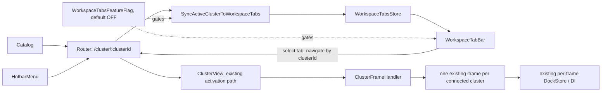

# R4-02 — Workspaces y pestañas por clúster: arquitectura implementada

**Fecha:** 2026-10-20/21  
**Worktree:** `/Users/gustavomarcon/Documents/lens/lens-r4`  
**Rama:** `feat/r4-workspace-security`  
**Estado:** **PARCIAL** — la UI y los recorridos principales pasan en el binario ARM64 con fixtures; la regresión completa no está verde y quedan límites de lifecycle y navegación.

## Alcance y decisiones

R4-02 agrega un tab visual por `clusterId`, dentro de un único workspace inicial (`default`). El modelo aún **no** permite cambiar entre varios workspaces ni persistir/restaurar sesiones; esos comportamientos no se atribuyen a este hito. La navegación existente por catálogo y hotbar abre o enfoca el tab del clúster de la ruta.

El tab es solo una superficie de navegación: no crea otro `Cluster`, kubeconfig, `ClusterFrame`, `DockStore` o conexión. Cada clúster conserva el `iframe` y el inyector/estado que ya gestiona `ClusterFrameHandler` y `ClusterView`. Cerrar un tab no borra el clúster, frame, proceso, terminal o port-forward. La restauración de sesiones y el lifecycle de herramientas quedan fuera del alcance.

## Arquitectura

- `WorkspaceTabsStore` mantiene un tab por `clusterId` en el workspace inicial. `tabId`, `workspaceId` y `clusterId` se declaran `readonly`; el título, entorno y color se actualizan desde las preferencias R2.
- El store usa `GetClusterById`, `NavigateToClusterView`, `NavigateToCatalog` y el logger existentes. No inicia una segunda activación Kubernetes al seleccionar; la ruta resultante sigue pasando por `ClusterView`, que ya activa el clúster y delega visibilidad del frame.
- Una reacción de la raíz sincroniza `/cluster/:clusterId` con el tab activo. La reacción no corre dentro de un cluster iframe. Si la ruta apunta a un ID inexistente, el store falla de forma cerrada hacia catálogo. El E2E confirmó que catálogo y hotbar llegan a tabs reales. No certifica back/forward arbitrario con muchas rutas: en el recorrido empaquetado se necesitó una vez volver a catálogo por su sidebar.
- `ClusterFrameHandler` sigue siendo el propietario del mapa de vistas. Los tabs no manipulan iframes directamente ni los crean/destruyen al seleccionarse; `ClusterView` elige el frame visible. `DockStore`, logs, terminal y editores siguen siendo los existentes dentro del frame correspondiente.
- Los iframes ocultos permanecen montados para no resetear estado. **Ocultar no significa suspender watchers**. La verificación sintética no observó solicitudes de watch, por lo que no acredita teardown, ahorro de CPU ni reducción de watchers.
- La garantía probada es de vinculación lógica entre ruta, tab, `clusterId` y frame. No se certifica aislamiento de proceso/renderer ni se presenta el iframe como frontera de seguridad entre credenciales Kubernetes; esa conclusión requiere evaluación de threat model separada.

## Identidad y seguridad visual

`WorkspaceTabBar` lee `clusterAlias`, `clusterColor`, entorno y estado desde las preferencias/entidad de ese `clusterId`. La barra muestra etiquetas explícitas `DEV`, `STG`, `PROD`, `TEST`, `LOCAL`, `CUSTOM` o `NONE`; PROD incluye texto accesible de advertencia, tratamiento rojo y borde, no solo color. Los badges se contrastaron en el E2E empaquetado para DEV/STG/PROD.

El entorno de producción se deriva del valor configurado `clusterEnvironment === "production"`; no se infiere del nombre del contexto. El cierre actúa sobre el tab seleccionado, no sobre el recurso Kubernetes. Esta señal visual **no reemplaza** autorización, confirmación de operación ni política de producción en acciones.

La barra expone `tablist`, `tab`, `aria-selected`, `aria-controls`, etiquetas accesibles y controles de teclado (flechas, Home/End y Delete/Backspace); el orden puede arrastrarse. El E2E empaquetado validó selección con teclado, foco/etiquetas, scroll horizontal y viewport de 900×650.

## Feature flag y fallback

`WorkspaceTabsFeatureFlag` queda desactivada por defecto. Se activa por argumento CLI (`--enable-workspace-tabs`), `OPENLENS_WORKSPACE_TABS=true`, parámetro de URL `enable-workspace-tabs`, `localStorage` (`openlens:workspace-tabs=true`) o `setEnabled(true)`. La suite unitaria aísla la activación CLI; el E2E empaquetado comprobó el fallback con el flag apagado. Cuando está apagada, no se renderiza la barra y `#lens-views` no recibe el offset de layout. Mantener el shell clásico apagado por defecto es requisito de rollout, no una declaración de equivalencia total de todos los recorridos.

## Archivos incorporados/modificados

- `packages/core/src/features/workspace-tabs/common/types.ts` y `workspace-tabs-feature-flag.injectable.ts`: contrato de tab y feature flag.
- `packages/core/src/features/workspace-tabs/renderer/workspace-tabs-store.ts`, `workspace-tabs-store.injectable.ts`, `sync-active-cluster-to-workspace-tabs.injectable.ts`: store de navegación, DI y sincronización con ruta.
- `packages/core/src/features/workspace-tabs/renderer/workspace-tab-bar.tsx` y `.scss`: UI accesible, identidad ambiental, manejo de teclas y reordenamiento.
- `packages/core/src/renderer/components/cluster-manager/cluster-manager.tsx` y `.scss`: montaje condicional y espacio de layout.
- `packages/core/src/renderer/components/cluster-manager/cluster-frame-handler.ts`: nombre, título y semántica accesible del frame; el ownership y lifecycle existentes se conservan.
- Tests de feature en `packages/core/src/features/workspace-tabs/renderer/__tests__/`.
- `docs/revival/scripts/verify-r4-02-workspace-tabs.cjs`: recorrido Playwright sobre el `.app` ARM64 con fixtures locales.

## Límites y trabajo pendiente

No se implementan workspaces múltiples, persistencia, restauración, selección de workspace, iconos de clúster por tab, aislamiento de procesos por tab ni lifecycle de watchers. El renderer conserva una sola ventana y los frames existentes. Cerrar el tab tampoco termina herramientas asociadas; falta una política de avisos/ownership para terminales y forwards en un hito posterior. La revisión completa de regresiones falló en snapshots de vistas existentes y una expectativa no visual; no se ejecutó un baseline limpio, por lo que su atribución sigue sin determinarse. Ver `R4_02_VALIDATION.md` y el checklist.
