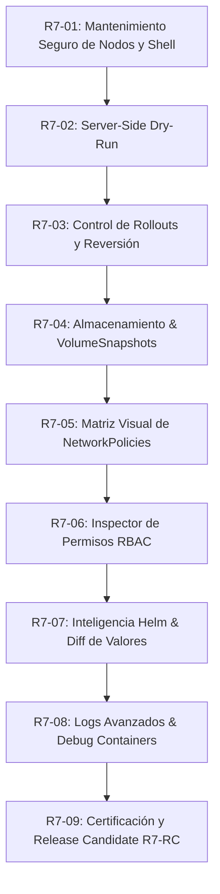

# OpenLens DevOps Revival — R7 Roadmap Provisional de Capacidades Avanzadas

**Fase:** Release 7 — Capacidades Operativas Avanzadas para SRE y DevOps
**Estado:** **R7-01 CONSOLIDADO / R7-02 CERTIFICADO (`11d4724`) / R7-03 CON CHECKPOINT LOCAL AUTORIZADO; GATES GLOBALES FALLIDOS, SIN CERTIFICACIÓN NI PUSH**
**Fecha:** 2026-10-23
**Arquitecto Principal:** Senior Architect & Software Engineer (OpenLens DevOps Revival)
**Autor del fork:** Gustavo Marcon
**Rama de trabajo:** `feat/r7-devops-capabilities`
**Base consolidada de partida:** Commit `731fb1ff4bf4b3cc1fb74972f1cb6428acdce6e0` (Release 6 consolidada)
**Checkpoint inmutable base:** R5-09 (`6012f4ac52da8c620d3fcae71d4fc406baa27081`)
**Release Candidate archivada:** `releases/R6-RC/OpenLens DevOps.app`

---

## 1. Visión y Principios Rectores de Release 7

Release 7 tiene como propósito transformar a OpenLens DevOps en la herramienta definitiva de trabajo diario para ingenieros SRE y operadores Kubernetes, cubriendo las lagunas funcionales que tradicionalmente forzaban a recurrir a la consola de comandos, pero manteniendo inquebrantables los principios fundacionales del proyecto:

1. **Local-First y Offline-Capable:** Todas las funcionalidades operan directamente contra el API server del clúster configurado en el `kubeconfig`. Sin servidores intermediarios, sin servicios SaaS y sin dependencia de conectividad externa.
2. **Cero Telemetría y Cero Código Propietario:** No se incorporan rastreadores, SDKs comerciales, muros de pago ni código descompilado de Mirantis. Todo el código es limpio, auditable y bajo licencia MIT.
3. **Seguridad Operacional Reforzada (PROD Guard Inviolable):** Ninguna acción de mantenimiento o mutación se ejecuta en entornos marcados como `PROD` sin confirmación explícita, advertencia visual roja `#EF4444` y salvaguarda de doble verificación con tipeo exacto de identificadores. Las salvaguardas de producción aplican a todos los hitos sin excepción.
4. **Ergonomía de Alta Densidad y Rendimiento:** Toda nueva pantalla o componente respeta la paleta **Midnight Graphite** (`#0D1117`), la densidad compacta de **33 px** generalizada a listados en Release 6 (sobre la preferencia de densidad disponible desde Release 5) y una rigurosa eficiencia de memoria y CPU validada mediante mediciones reproducibles.
5. **Independencia de Hitos:** Cada hito de R7 está diseñado para ser pequeño, autocontenido, testeable de forma aislada y con empaquetado verificable.

---

## 2. Plan Secuencial de Hitos (R7-01 a R7-09)

---

### Hito R7-01: Mantenimiento Seguro de Nodos y Shell del Sistema

- **Estado:** **COMPLETADO Y CERTIFICADO (100% PASS)** (Jest: 16/16, Playwright: 7/7, Evidencias: 7 capturas).
- **Valor Operativo:** Permite acordonar, desacordonar y drenar nodos ante mantenimientos de infraestructura de forma visual, controlada y segura, con pre-flight preview exhaustivo y tratamiento de Node Shell como operación altamente privilegiada.
- **Arquitectura y Estrategia:**
  - Agregar `NodeMenu` al sistema de inyección de menú de objetos (`kubeObjectMenuItemInjectionToken`).
  - `Cordon / Uncordon`: parche seguro sobre el recurso `Node` modificando `spec.unschedulable` mediante strategic merge patch.
  - `Drain`: Diálogo modal compacto con previsualización obligatoria de pods afectados, controladores, PDBs y pods con `emptyDir`. Valores por defecto seguros: `--ignore-daemonsets=true`, `--delete-emptydir-data=false` (NO permitir borrado de datos locales por defecto), `--force=false`, `--disable-eviction=false`. Exigir confirmación tipeando el nombre exacto del nodo. Advertencia crítica en clústeres de un solo nodo.
  - `Node Shell`: Tratada estrictamente como operación privilegiada de administración de host (`privileged: true`, `hostPID: true`, `nsenter`). Mantener deshabilitada por defecto; en PROD bloqueada por defecto salvo habilitación explícita en configuración. Cero creación automática de pods privilegiados en tests.
  - Salvaguarda PROD: Confirmación reforzada con banner rojo `#EF4444` y confirmación de clúster.
- **Dependencias:** Endpoint API de nodos (`node.api.ts`), `pod.store.ts`, `pod-disruption-budget.store.ts`, `is-production-cluster.injectable.ts`.
- **Riesgos y Mitigaciones:** **RIESGO ALTO**. Riesgo de interrupción de servicio o pérdida de datos locales. Mitigado por preview obligatoria, no borrado de `emptyDir` por defecto, respeto irrestricto de PDBs, tipeo obligatorio del nombre del nodo y confirmación de clúster en PROD.
- **Complejidad:** Media-Alta.
- **Criterios de Aceptación:**
  - Unit tests: Pruebas unitarias de `NodeMenu` y `DrainDialog` verificando Cordon, Uncordon, análisis de PDBs, detección de `emptyDir`, bloqueo de tipeo y salvaguardas PROD.
  - E2E Playwright: Verificación en fixture local de transición a `SchedulingDisabled`, apertura de diálogo Drain con pre-flight preview y rechazo sin nombre de nodo. Cero pods privilegiados creados.

---

### Hito R7-02: Validación Pre-Vuelo y Server-Side Dry-Run (`dryRun=All`)

- **Estado:** **COMPLETADO Y CERTIFICADO** (2026-10-23) — implementado sobre `6514e4dffad63fc4d501a0b4d82a8e687a022594`, verificado con 11 suites / 148 tests Jest y 18/18 checkpoints Playwright sobre build ARM64 experimental. **Sin commit** (pendiente de revisión independiente). Ver `R7_02_ARCHITECTURE.md`, `R7_02_IMPLEMENTATION.md`, `R7_02_VALIDATION.md` y `R7_02_VERIFICATION.json`.
- **Implementación real:**
  - `KubeApi.create/update/patch` aceptan `KubeApiDryRunOptions` (`dryRun: "All"`) y lo transmiten como query param por la infraestructura existente de `JsonApi`.
  - `EditResourceModel.validateDraft()` reutiliza la ruta de guardado (PUT con `resourceVersion` original para ConfigMap/Secret; JSON PATCH con precondiciones `test` para el resto) con `?dryRun=All`.
  - Estado observable `draftValidation` (`not-validated`, `validating`, `passed`, `failed`, `unavailable`) con invalidación por revisión de borrador y descarte de respuestas tardías.
  - Resultado estructurado: 400/403/404/409/422 con causes, admission webhook, conexión/timeout y YAML mal formado; redacción de Secrets en mensajes y causas.
  - UI: acción `Validate — Server Dry-Run`, badge de estado, banner de resultado (nunca afirma guardado) y marcadores Monaco solo con correspondencia fiable.
  - `json-api` redacta manifiestos Secret antes del log de debug.
- **Valor Operativo:** Evita errores `422 Unprocessable Entity` y fallas en producción permitiendo validar sintaxis, esquemas, campos inmutables y políticas de admisión en el servidor de Kubernetes antes de aplicar cualquier cambio.
- **Arquitectura y Estrategia:**
  - Extender `EditResourceModel` y `KubeApi` para soportar el parámetro `dryRun: "All"`.
  - Agregar botón `Dry Run` en la barra de herramientas del `MonacoEditor` junto a `Save & Close` y `Diff`.
  - Integrar llamada HTTP `PUT/POST?dryRun=All` al API server.
  - Procesar la respuesta: si es exitosa, mostrar banner verde temporal `Admitted by Kubernetes API server (0 errors)`. Si falla, capturar el mensaje exacto del webhook o política rechazante y resaltar la línea en el editor.
  - Salvaguarda: No presentar server-side dry-run como garantía absoluta de ausencia de efectos secundarios de mutating webhooks externos.
- **Dependencias:** `kube-api.ts`, `edit-resource-model.injectable.tsx`, `monaco-editor`.
- **Riesgos y Mitigaciones:** Riesgo bajo; el servidor Kubernetes garantiza que no persiste en etcd, pero se informa al operador sobre posibles diferencias de comportamiento en webhooks mutantes.
- **Complejidad:** Baja-Media.
- **Criterios de Aceptación:**
  - Unit tests: Mock de `KubeApi.update` con `dryRun: "All"` validando paso exitoso y captura de rechazos `422`.
  - E2E Playwright: Apertura de recurso en editor, clic en "Dry Run", verificación del banner de validación.

---

### Hito R7-03: Control de Rollouts y Reversión de Cargas de Trabajo

- **Estado:** Correcciones de seguridad aplicadas; tests dirigidos y E2E vigente aprobados. La suite global de core y el lint global siguen fallidos y quedan documentados con comparación dirigida en `R7_03_VALIDATION.md`. Se autoriza solo un checkpoint local, **sin certificación global ni push**.
- **Entregado:**
  - Historial de revisiones desde `ReplicaSet` con ownership, poda, gaps, duplicados y `change-cause`.
  - Diff de solo lectura entre revisión actual y histórica.
  - Rollback en 5 pasos con identidad Deployment/ReplicaSet validada, templates frescos, `PATCH ?dryRun=All`, relectura antes de ejecutar, ack de rollout en curso y polling con resultado terminal visible.
  - Pause/Resume con JSON Patch, precondiciones UID/resourceVersion y confirmación PROD ligada a clúster/namespace/recurso.
  - Historial read-only de `ControllerRevision` con `revision` y `data` en raíz; formatos no reconocidos muestran `Not available`.
  - Guardas PROD: banner, checkbox y nombre exacto del Deployment.
  - Tests negativos para sustitución/poda de ReplicaSets, respuestas tardías, cambio de contexto, doble ejecución, timeout y errores persistentes de polling.
- **Valor Operativo:** Provee visibilidad completa del historial de despliegues y capacidad de rollback instantáneo ante fallos en Deployments, StatefulSets y DaemonSets sin necesidad de recordar comandos CLI complejos.
- **Arquitectura y Estrategia:**
  - **Rollout History:** Consultar los `ReplicaSets` históricos del Deployment ordenados por la anotación `deployment.kubernetes.io/revision`. Extraer imagen, fecha de creación y anotación `kubernetes.io/change-cause`.
  - **Rollout Undo:** Diálogo de reversión permitiendo seleccionar la revisión objetivo (por defecto N-1) y aplicando el parche de template correspondiente al Deployment.
  - **Rollout Pause & Resume:** Menú interactivo para pausar (`spec.paused: true`) y reanudar despliegues progresivos.
- **Dependencias:** `deployment.api.ts`, `replica-set.store.ts`, `workloads-deployments`.
- **Riesgos y Mitigaciones:** En entornos `PROD`, el rollback debe mostrar un diff claro entre la imagen y configuración actual versus la revisión a la cual se revierte.
- **Complejidad:** Media.
- **Criterios de Aceptación:**
  - Unit tests: Cálculo correcto del historial de revisiones a partir de ReplicaSets huérfanos/activos.
  - E2E Playwright: Despliegue simulado con 2 revisiones, verificación de la tabla de historial en el Drawer de detalles y ejecución de Rollout Undo volviendo a la revisión previa.

---

### Hito R7-04: Almacenamiento Moderno: Instantáneas de Volúmenes (VolumeSnapshots)

- **Valor Operativo:** Otorga visibilidad y control sobre copias de seguridad de volúmenes persistentes gestionados por CSI (AWS EBS, GCP PD, Longhorn, Ceph, etc.) y redimensionado de PVCs en caliente.
- **Arquitectura y Estrategia:**
  - Registrar las APIs de `snapshot.storage.k8s.io/v1`:
    - `VolumeSnapshot`
    - `VolumeSnapshotClass`
    - `VolumeSnapshotContent`
  - Crear stores y vistas bajo la categoría `Storage` en el sidebar del clúster, con descubrimiento dinámico (solo visibles si los CRDs de snapshot están presentes en el clúster).
  - Acción "Create VolumeSnapshot" en el menú contextual de PersistentVolumeClaims.
  - Acción "Expand PVC" en PVCs cuyo StorageClass declare `allowVolumeExpansion: true`.
- **Dependencias:** `storage-volume-claims`, `api-manager`, descubrimiento dinámico de APIs.
- **Riesgos y Mitigaciones:** Si el clúster no tiene instalado el snapshot-controller de CSI, la interfaz oculta la sección con elegancia gracias a la verificación de API discovery.
- **Complejidad:** Media.
- **Criterios de Aceptación:**
  - Unit tests: Stores de VolumeSnapshot y VolumeSnapshotClass, renderizado de tablas y validación de permisos.
  - E2E Playwright: Inyección de fixtures de VolumeSnapshots, verificación de aparición en el sidebar bajo Storage y apertura de panel de detalles.

---

### Hito R7-05: Visualizador y Matriz de Políticas de Red (NetworkPolicy Matrix)

- **Valor Operativo:** Resuelve una de las tareas más opacas en seguridad Kubernetes: entender qué tráfico está permitido o bloqueado en un namespace o pod específico.
- **Arquitectura y Estrategia:**
  - Crear componente `NetworkPolicyMatrix` dentro del detalle de `NetworkPolicies` y en la pestaña de red de los Pods.
  - Evaluar las reglas de la política:
    - Identificar si aplica `DefaultDenyIngress` o `DefaultDenyEgress` (selector de pod vacío `{}`).
    - Resolver selectores de pod (`podSelector`) y namespaces (`namespaceSelector`) hacia los recursos vivos en el clúster.
    - Generar diagrama/grilla compacta de tráfico: Fuentes de Ingress -> Puertos habilitados -> Destinos de Egress.
- **Dependencias:** `network-policies.tsx`, `pod.store.ts`, `namespace.store.ts`.
- **Riesgos y Mitigaciones:** Cero impacto en el clúster (componente 100% de lectura y análisis en el cliente).
- **Complejidad:** Media.
- **Criterios de Aceptación:**
  - Unit tests: Algoritmo de emparejamiento de selectores de red (evaluación de reglas CIDR, namespaceSelector y podSelector).
  - E2E Playwright: Visualización de matriz de tráfico con pod aislado y pod permitido en el detalle de la política.

---

### Hito R7-06: Inspector de Permisos y Simulación RBAC (`auth can-i`)

- **Valor Operativo:** Permite auditar y depurar permisos al instante: *"¿Puede este ServiceAccount listar secrets en el namespace X?"* o *"¿Quién tiene acceso de administración en este clúster?"*.
- **Arquitectura y Estrategia:**
  - Crear herramienta **RBAC Permission Inspector** en el menú de navegación y en el Drawer de `ServiceAccounts`.
  - Implementar consulta contra el endpoint estándar de Kubernetes `SelfSubjectAccessReview` (para el usuario actual) y `SubjectAccessReview` (para ServiceAccounts o usuarios específicos).
  - Matriz de permisos interactiva: selector de Namespace, Recurso y Verbo, devolviendo `ALLOWED` o `DENIED` junto con el nombre del RoleBinding responsable.
- **Dependencias:** `user-management`, `cluster-connection`, K8s Authorization API.
- **Riesgos y Mitigaciones:** Si el usuario no tiene permisos para crear `SubjectAccessReview`, la herramienta degrada automáticamente a inspección local de `RoleBindings` y `ClusterRoleBindings` ya cargados en memoria.
- **Complejidad:** Media.
- **Criterios de Aceptación:**
  - Unit tests: Parseo de respuestas `SubjectAccessReview` y cálculo de permisos efectivos locales.
  - E2E Playwright: Simulación de consulta `can-i get secrets` en namespace default, verificando la visualización del veredicto `ALLOWED`/`DENIED`.

---

### Hito R7-07: Inteligencia de Ciclo de Vida Helm (Historial y Diff de Valores)

- **Valor Operativo:** Transforma la gestión de Helm en una experiencia profesional para DevOps, eliminando el miedo a ejecutar `helm upgrade` mediante la comparación de valores entre revisiones y validación de esquemas.
- **Arquitectura y Estrategia:**
  - Extender `HelmRelease` para consultar el historial completo de versiones (`helm.sh/release.v1` secrets en el namespace).
  - **Revision History:** Tabla en el Drawer de Release mostrando número de revisión, fecha, estado, chart version y app version.
  - **Monaco Values Diff:** Selector de dos revisiones para desplegar un `MonacoDiffEditor` que resalte exactamente qué líneas cambiaron en `values.yaml`.
  - **Validación contra `values.schema.json`:** Validación en el editor antes de aplicar el upgrade para detectar tipos erróneos o campos obligatorios faltantes.
- **Dependencias:** `helm-releases`, `monaco-editor`, `release-details-content.tsx`.
- **Riesgos y Mitigaciones:** Cero riesgo de corrupción de releases; la lectura del historial se realiza directamente desde los Secrets de Helm existentes en el clúster.
- **Complejidad:** Media.
- **Criterios de Aceptación:**
  - Unit tests: Extracción de historial a partir de Secrets de release de Helm y formateo de manifiestos.
  - E2E Playwright: Apertura de release Helm con 2 revisiones históricas y visualización de la vista diferencial de valores.

---

### Hito R7-08: Diagnóstico Avanzado de Pods y Ergonomía de Logs

- **Valor Operativo:** Acelera drásticamente la resolución de incidentes (MTTR) permitiendo depurar pods distroless en CrashLoopBackOff mediante contenedores efímeros (`kubectl debug`) y analizar logs con acotación temporal y formateo JSON.
- **Arquitectura y Estrategia:**
  - **Ephemeral Debug Containers (`kubectl debug`):**
    - Agregar acción "Attach Debug Container" en el menú DevOps de Pods.
    - Diálogo modal con selector de imagen preconfigurada (`busybox`, `nicolaka/netshoot`, `alpine`, `curl`) o imagen personalizada.
    - Llamada a la sub-recurso `/ephemeralcontainers` del Pod (K8s 1.25+ GA).
    - Apertura inmediata de terminal interactiva adjunta al contenedor efímero.
  - **Ergonomía de Logs:**
    - Agregar selectores de límite temporal (`Since`: 15m, 1h, 4h, 24h, All) y tamaño de búfer (`Tail`: 100, 500, 1000, All).
    - Conmutador de formato JSON estructurado: si la línea es un JSON válido, formatear con coloreado de campos (`level`, `msg`, `time`, `caller`).
  - **Capacidad y Cuotas (Headroom):**
    - Barras de progreso de cuota en la lista de Namespaces y Cluster Overview (CPU/RAM/Pods consumidos vs límite) con alertas visuales al superar 80% y 90%.
- **Dependencias:** `dock/logs`, `workloads-pods`, `pod-devops-menu`, `config-resource-quotas`.
- **Riesgos y Mitigaciones:** En clústeres `PROD`, la inyección de contenedores efímeros requiere confirmación explícita para evitar que imágenes de depuración permanezcan innecesariamente en el pod de producción.
- **Complejidad:** Media.
- **Criterios de Aceptación:**
  - Unit tests: Parseo de líneas de logs JSON, formateo de parámetros `sinceSeconds`/`tailLines` en solicitudes de logs, y payload de `ephemeralcontainers`.
  - E2E Playwright: Controles de logs con selector temporal y visualización de barra de headroom en cuotas.

---

### Hito R7-09: Certificación Integral y Consolidación de Release 7 (R7-RC)

- **Valor Operativo:** Garantiza que la totalidad de Release 7 está probada, empaquetada y certificada sin ninguna regresión sobre las capacidades históricas (R1 a R6).
- **Arquitectura y Estrategia:**
  - Ejecución integral de la suite de pruebas unitarias Jest (>90 tests).
  - Ejecución de suite de integración Playwright en binario real macOS ARM64 en resoluciones 1440x900 y 1920x1080.
  - Comprobación estricta de paridad de temas (Midnight Graphite, Dark, Light) y contratos de densidad de tabla (33 px / 42 px).
  - Empaquetado final y archivado en `releases/R7-RC/OpenLens DevOps.app` con generación de `BUILD_INFO.txt` y hashes SHA-256 reales.
  - Auditoría final y reporte `R7_09_VALIDATION.md`.
- **Dependencias:** Todos los hitos precedentes (R7-01 a R7-08).
- **Riesgos y Mitigaciones:** Salvaguarda de espacio en disco (mantener >14 GiB libres purgando etapas temporales de build).
- **Complejidad:** Media.
- **Criterios de Aceptación:**
  - 100% de tests estáticos, unitarios y E2E aprobados.
  - Binario empaquetado y archivado con SHA-256 verificado.
  - Checkpoint R6 y R5-09 intactos.

---

## 3. Resumen de Cronograma y Esfuerzo

| Hito | Área Funcional Clave | Entregables Principales | Impacto en el Operador |
|---|---|---|---|
| **R7-01** | Fleet & Nodos | Cordon, Uncordon, Drain modal seguro, Node Shell | Operación completa de mantenimiento de clúster |
| **R7-02** | Seguridad de Aplicación | Botón Server-Side Dry-Run (`dryRun=All`) en editor | Prevención de errores 422 y caídas por admission webhooks |
| **R7-03** | Rollouts de Cargas | Historial de revisiones, Rollback Undo, Pausa/Reanudación | Rescate instantáneo ante despliegues fallidos |
| **R7-04** | Almacenamiento Moderno | VolumeSnapshots CSI y redimensionado de PVCs | Gestión de backups y expansión de almacenamiento en vivo |
| **R7-05** | Seguridad de Red | Matriz interactiva de NetworkPolicies y default-deny | Comprensión inmediata del flujo y aislamiento de red |
| **R7-06** | Auditoría y RBAC | Herramienta `auth can-i` y permisos efectivos | Diagnóstico ágil de accesos y errores 403 Forbidden |
| **R7-07** | Helm Intelligence | Historial de versiones, Diff de values y validación JSON | Despliegue y actualización de charts sin riesgos |
| **R7-08** | Diagnóstico & Logs | Contenedores efímeros `kubectl debug`, tail/since y JSON logs | Reducción dramática del MTTR en incidentes |
| **R7-09** | Certificación Final | Suite E2E, empaquetado ARM64, hashes SHA-256, R7-RC | Release Candidate certificada y lista para entrega |

---

## 4. Próximos Pasos

1. Cerrar y revisar el gate final de R7-03.
2. No iniciar R7-04 hasta recibir autorización explícita después de la revisión de R7-03.
