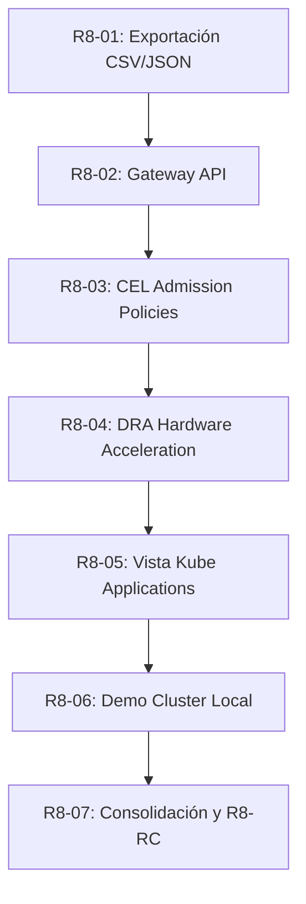

# OpenLens DevOps — Propuesta y Arquitectura Release 8 (R8)

**Fase:** Release 8 — Modern Kubernetes APIs & Operator Productivity  
**Estado:** **PROPUESTA APROBADA — FASE DE ESPECIFICACIÓN Y DISEÑO**  
**Fecha:** 2026-10-24  
**Autor / Arquitecto:** Gustavo Marcon  
**Base de partida:** Commit `03c2435` (`feat/r7-09-consolidation` / R7-RC)  
**Licencia:** MIT (100% Clean-Room Implementation)  

---

## 1. Principio de Ingeniería Inversa Clean-Room (Aislamiento de Propiedad Intelectual)

Para garantizar la integridad legal del proyecto y la pureza de la licencia MIT:
1. **Cero Copy-Paste de Código Propietario:** No se copia código fuente extraído del binario propietario de Mirantis (`lens-app`, `license: UNLICENSED`).
2. **Uso como Especificación Funcional:** La extracción de ingeniería inversa se utiliza exclusivamente como referencia para entender los esquemas de CRDs, tipos de Kubernetes (`gateway.networking.k8s.io`, `admissionregistration.k8s.io`), contratos de tablas y comportamientos esperados por los usuarios.
3. **Implementación Nativa y Limpia:** Todo el código se escribe desde cero de forma nativa e idiomática en OpenLens DevOps utilizando TypeScript, MobX y `@ogre-tools/injectable`, sin dependencias comerciales, sin telemetría y sin dependencias propietarias (`@lensapp/*`).

---

## 2. Filosofía de Testing Pragmático

Se adopta una política estricta de **calidad sobre cantidad**:
- **Tests Unitarios Esenciales:** Pruebas unitarias focalizadas exclusivamente en parsers, serializadores (CSV/JSON) y lógica de estado del Store/Modelo.
- **Tests de Componentes Concisos:** 1 suite enfocada por módulo que verifique el renderizado de la UI, la presencia de elementos interactivos clave y el manejo de errores (403/404).
- **Pruebas de Integración E2E Acotadas:** 1 escenario Playwright de humo en Electron real por hito para validar la navegación, carga de datos simulados y ausencia de mutaciones no deseadas.
- **Sin Inflación de Pruebas:** Evitar la creación de suites redundantes o hiper-especificadas que aumenten los tiempos de compilación sin agregar valor de aseguramiento.

---

## 3. Alcance de Hitos de Release 8

### R8-01: Exportación de Datos de Tablas (CSV / JSON / Clipboard)
- **Objetivo:** Permitir volcar los datos tabulares de cualquier vista (Pods, Deployments, Nodos, etc.) a formatos portables para auditoría y reportes.
- **Arquitectura:**
  - Extensión a nivel de `ItemListLayout` / cabecera de tabla.
  - Serializador puro que toma las columnas activas y los datos filtrados en pantalla.
  - Sanitización anti-CSV Injection (prefijar apóstrofe `'` en campos que inicien con `=`, `+`, `-`, `@`).
  - Generación de Blob en memoria y descarga vía `showSaveDialog` de Electron o copia a portapapeles.
- **Testing:** 1 suite unitaria para el serializador/sanitizador y 1 test de componente para el botón de exportación.

### R8-02: Soporte Nativo para Gateway API (K8s 1.28+)
- **Objetivo:** Incorporar soporte de primera clase para la evolución de la red en Kubernetes (`gateway.networking.k8s.io`).
- **Arquitectura:**
  - KubeObjects: `GatewayClass`, `Gateway`, `HTTPRoute`, `GRPCRoute`, `TLSRoute`, `ReferenceGrant`.
  - Integración en el menú lateral bajo la sección **Network**.
  - Detalle de recursos: visualización de direcciones asignadas, listeners activos, certificados TLS asociados y rutas enlazadas (*attached routes*).
- **Testing:** 1 suite de modelos/deserialización y 1 test de renderizado de la vista de Gateways y Routes.

### R8-03: Validating & Mutating Admission Policies (CEL)
- **Objetivo:** Soporte visual para la auditoría de políticas de admisión nativas declarativas (K8s 1.26+ GA en 1.30+).
- **Arquitectura:**
  - KubeObjects: `ValidatingAdmissionPolicy`, `ValidatingAdmissionPolicyBinding`, `MutatingAdmissionPolicy`.
  - Vista dedicada para auditar expresiones CEL, scopes de recursos, failure policies y match constraints.
- **Testing:** 1 suite de parsing de condiciones CEL y 1 test de visualización de políticas.

### R8-04: Dynamic Resource Allocation (DRA)
- **Objetivo:** Gestión y visualización de reservas de hardware especializado (GPUs, FPGAs, aceleradores) vía `resource.k8s.io`.
- **Arquitectura:**
  - KubeObjects: `ResourceClaim`, `ResourceClaimTemplate`, `DeviceClass`.
  - Integración en la vista de Nodos y Pods para inspeccionar hardware asignado.
- **Testing:** 1 suite unitaria de parseo de claims y 1 verificación en UI.

### R8-05: Vista de Aplicaciones Agrupadas ("Kube Applications")
- **Objetivo:** Proporcionar una visión holística orientada al servicio, agrupando Deployments, Services, ConfigMaps e Ingresses/Routes bajo una sola tarjeta de aplicación.
- **Arquitectura:**
  - Motor de agregación por etiquetas estándar (`app.kubernetes.io/name`, `app.kubernetes.io/instance`, Helm release labels).
  - Tarjeta de salud consolidada con estado de pods y endpoints.
- **Testing:** 1 suite unitaria para el agregador de etiquetas y 1 test de renderizado del catálogo de aplicaciones.

### R8-06: Demo Cluster Local Simulado
- **Objetivo:** Permitir a nuevos usuarios o sesiones offline explorar OpenLens DevOps sin necesidad de clústeres reales o Docker/Minikube.
- **Arquitectura:**
  - Reutilización del harness HTTP loopback (`127.0.0.1`) desarrollado y certificado en R7.
  - Opción "Launch Demo Cluster" en la pantalla de bienvenida y catálogo.
  - Clúster 100% de solo lectura en memoria.
- **Testing:** 1 test de arranque del fixture local y conexión del cliente.

### R8-07: Consolidación, Regresión y Release Candidate (R8-RC)
- **Objetivo:** Integración global, suite Playwright E2E completa, verificación de paridad visual (Midnight Graphite, Dark, Light) y empaquetado ARM64.
